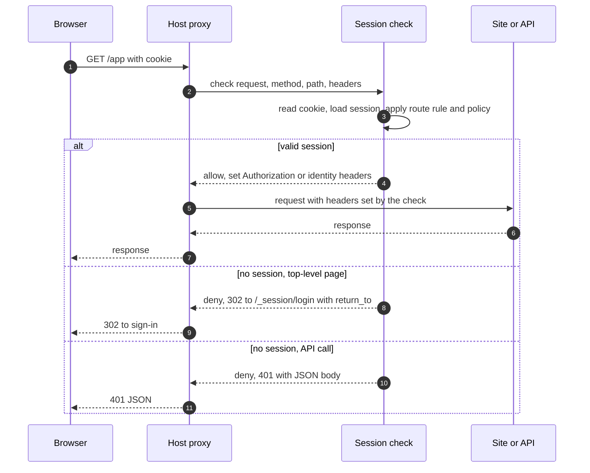
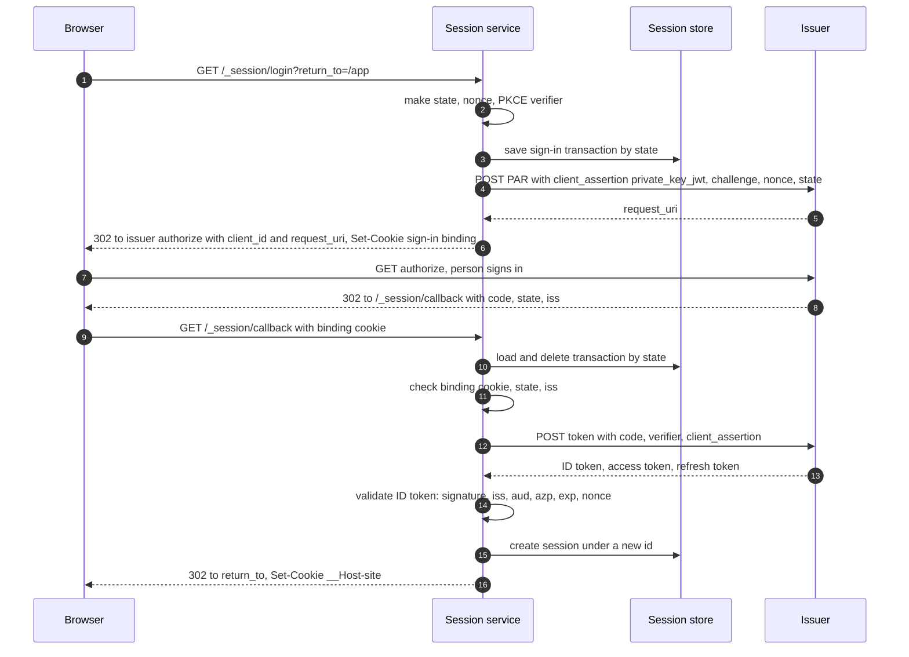
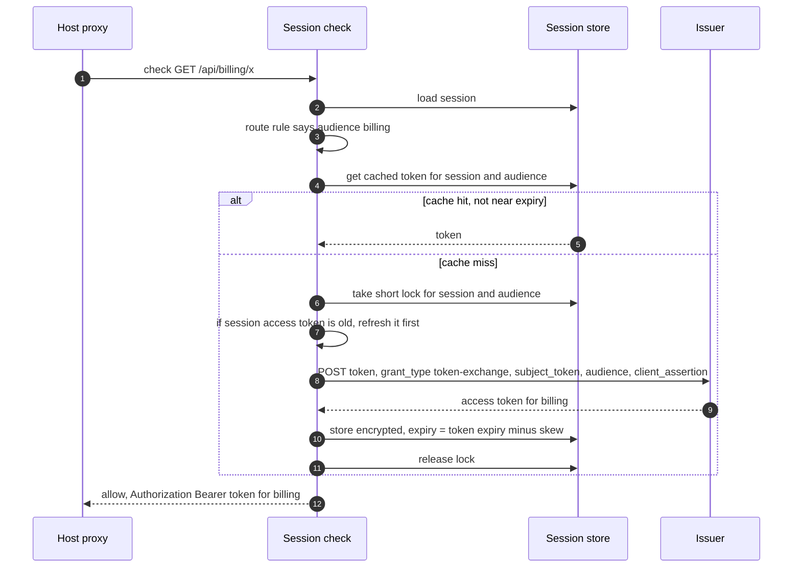
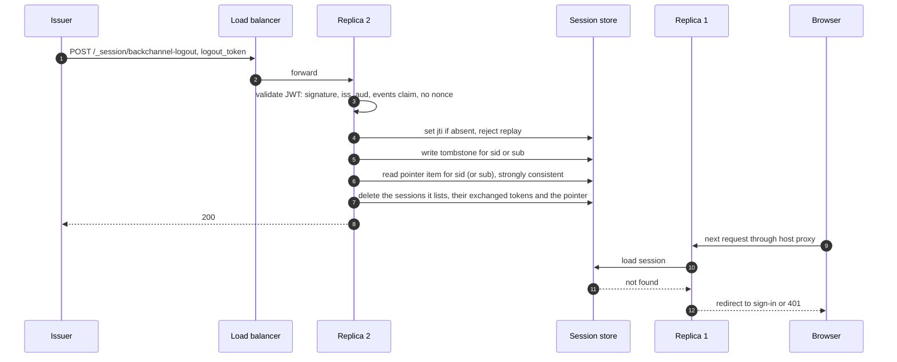

# Design of truvity/session

Status: design. No production code yet: `spike/` holds throwaway prototype code from the first spike ([findings](archive/spike-2026-11-18.md)). The state of each part is in section 16.

The decisions are in [docs/decisions](decisions/README.md), one record for each subject. This document puts them together and shows how the parts work. Where it states a rule, the record has the reasons and the roads not taken.

## 1. Purpose

`session` is a relying-party component. After an issuer has signed a person in, `session` keeps the website's browser session on the server ([0001](decisions/0001-purpose-scope-and-name.md)).

- The browser holds one opaque cookie. Tokens never reach the browser.
- The proxy in front of the site asks `session` before each request: may this pass, and with which headers?
- The issuer is sluis. Keycloak is used to build and test first.

What it replaces: the OIDC filter of Envoy Gateway, which keeps tokens in browser cookies.

What it does not replace: any part of the sluis issuer core. `session` is a client of the issuer, not a second issuer.

## 2. Goals and non-goals

| Goals | Non-goals |
| --- | --- |
| Server-side browser session for a website | Being an identity provider |
| One check core for every proxy | Authenticating API callers without a browser (the per-API door of sluis) |
| Per-API tokens, never one token valid everywhere | A policy language of its own. Cedar decides who may reach a route ([0007](decisions/0007-policy.md)); what a person may do inside an API is that API's decision |
| Works behind Envoy Gateway, nginx and AWS API Gateway | Reading request bodies |
| Small, auditable, written in Go, built on atoom | Managing issuer clients or Keycloak realms |
| Security-audit events for sign-ins, logouts and denials | Usage or billing records, ever ([0008](decisions/0008-audit.md)) |

## 3. Overview

```text
 browser  ->  host proxy  ->  site
                 |
                 +--  "may this pass?"  -->  session check  -->  session store
                                                  |
                                                  +--  sign-in, token exchange, logout  -->  issuer
```

One check core does the work. Adapters only translate between a proxy's protocol and the core.

| Piece | Job |
| --- | --- |
| Check core | Reads the cookie, loads the session, decides allow, redirect or 401, builds the headers. It is a block ([0009](decisions/0009-session-core-block.md)) |
| Adapters | Envoy external authorisation (HTTP and gRPC), nginx `auth_request`, AWS API Gateway Lambda authorizer |
| Sign-in handler | Login, callback, logout, back-channel logout, whoami, jwks |
| Exchange client | Gets and caches a token for each API audience (RFC 8693) |
| atoom ports and blocks | `store`, `key`, `source`, `transport`, and the `seal` block, called through ConnectRPC clients with the drivers in-process (section 9). Cedar is a library |
| In-path mode | The same service as a reverse proxy, for sites where one more hop is fine |

Libraries: `coreos/go-oidc`, `golang.org/x/oauth2`, `go-jose`, `cedar-go`. We write the glue, not the cryptography.

## 4. Deployment: external authorisation

The host proxy asks `session` before each request. `session` is not in the data path ([0002](decisions/0002-own-go-service-and-external-authorisation.md)).



Rules of this mode:

- The proxy sends only headers. The check never sees the body.
- The proxy strips `Authorization`, `Cookie` and identity headers that came from the browser. The allow answer sets the real ones. The example configs ship this.
- The sign-in paths (`/_session/*`) are routed to the service without a check, because they run before a session exists.
- The check fails closed. If the store is down, the answer is 503, never allow. The check bounds every store call with its own timeout (1.5 s in the first spike), and the proxy's timeout for the check is longer, so the check's 503 is the one the client sees. On nginx the example turns the check's markers, and a check that cannot be reached, into the same 503 ([0018](decisions/0018-nginx-adapter.md)).
- The check must see the same normalised path the proxy routes on. Each host example ships the settings for it.

Hosts:

| Host | How it asks | Notes |
| --- | --- | --- |
| Envoy Gateway | `SecurityPolicy` with external authorisation. gRPC mode is preferred, HTTP mode is documented | Header removal (`headers_to_remove` in gRPC, `x-envoy-auth-headers-to-remove` in HTTP), `allowed_headers` with `x-requested-with`, path normalisation, per-route disable ([0015](decisions/0015-envoy-http-mode-csrf-header-and-step-2-choices.md)) |
| nginx | `auth_request` with `auth_request_set` | Self-hosted installs. Every refusal is a 401 with markers that the example turns into the check's own answer; `$uri$is_args$args` set in the protected location; raw paths that differ from `$uri` refused; one `Set-Cookie`; 503 on failure ([0018](decisions/0018-nginx-adapter.md)) |
| AWS API Gateway | Lambda authorizer, for both the REST API and the HTTP API (payload 2.0). The docs default to the HTTP API | Cannot redirect, cannot set or remove headers, cannot send `Set-Cookie`. The authorizer cache is set to 0. Stripping is the integration's parameter mapping. The HTTP API cannot map `Authorization`, so the per-API token uses `X-Session-Token` |

The rules for each host, and the reasons, are in [0011](decisions/0011-host-adapter-rules.md), with [0015](decisions/0015-envoy-http-mode-csrf-header-and-step-2-choices.md) for Envoy and [0018](decisions/0018-nginx-adapter.md) for nginx. Every Lambda function runs behind the Web Adapter ([0012](decisions/0012-lambda.md)), except the authorizer, which is a native Go handler in the same binary ([0014](decisions/0014-authorizer-native-go-handler.md)).

The in-path mode is a plain reverse proxy that runs the same check, then forwards the request. It costs a hop, so it is for sites where that is fine.

## 5. Behaviour contract

These are the rules every host gets. They do not depend on the proxy ([0004](decisions/0004-browser-session-contract.md)).

| Id | Rule |
| --- | --- |
| S1 | Cookie `__Host-<site>`: opaque id, `Secure`, `HttpOnly`, `SameSite=Lax`, `Path=/`, no `Domain` |
| S2 | Sessions live on the server, sealed, in an atoom store driver. Each site has an idle and a maximum lifetime |
| S3 | Sign-in uses authorisation code with PKCE, always. PAR and `private_key_jwt` are used |
| S4 | Page without session: redirect to sign-in. API call: JSON 401. The API Gateway authorizer cannot redirect, so it returns the error `Unauthorized` (401, never a deny policy) and the browser helper starts sign-in. nginx makes the redirect and the 401 from the markers of the check's 401, with the check's own body |
| S5 | State-changing requests need CSRF protection: the header `X-Requested-With: XMLHttpRequest` plus `Origin` and `Sec-Fetch-Site` checks. Headers only ([0015](decisions/0015-envoy-http-mode-csrf-header-and-step-2-choices.md)) |
| S6 | Logout is a POST with CSRF, then the issuer's end-session. Back-channel logout deletes the session on all replicas |
| S8 | The browser's `Authorization`, cookies and identity headers are stripped. In external authorisation the host strips and the allow answer sets them (section 4) |

There is no S7. The ids are the ones the conformance suite cites.

### 5.1 Session record

| Field | Content |
| --- | --- |
| id | 256 random bits, only in the cookie. The store key is a keyed hash of it, so a store leak gives no usable cookie |
| subject, issuer, `sid` | From the ID token. Pointer items for back-channel logout hold the session keys under `sid` and subject (section 8) |
| tokens | The sign-in access token and refresh token |
| exchanged tokens | Not in the record: one item for each audience under the session's store key, see section 7 |
| created, last seen, expires | Idle and maximum lifetime. `created` is in milliseconds, for the logout comparison (section 8) |
| claims | The person's claims cached at sign-in, which the policy decision reads (section 9) |

The record is sealed by atoom's `seal` block and bound to its address (session id and purpose) as authenticated data. A record copied under another id does not open. The data keys are per purpose and installation and are wrapped by the key port, so they can be rotated.

A new id is issued at sign-in, so a session id set before sign-in is never reused (no fixation).

Idle time is refreshed at most once a minute, to keep writes down. The default lifetimes are 30 minutes idle and 8 hours maximum. Each site sets its own.

### 5.2 Paths

`session` owns one prefix on every site, `/_session/` by default.

| Path | Method | Purpose |
| --- | --- | --- |
| `/_session/login` | GET | Start sign-in. `return_to` must be a relative path of the same site |
| `/_session/callback` | GET | Receive the code from the issuer |
| `/_session/logout` | POST | End the session. Needs CSRF headers. Answers `200 {"logout_url"}` to a request that accepts JSON, else `303` to the issuer's end-session ([0015](decisions/0015-envoy-http-mode-csrf-header-and-step-2-choices.md)) |
| `/_session/backchannel-logout` | POST | Called by the issuer |
| `/_session/whoami` | GET | JSON: subject, name, groups, session expiry |
| `/_session/jwks` | GET | Public keys of the service, for apps that verify the signed identity header |

### 5.3 Unauthenticated requests

A route says what to do without a session: `redirect` or `401`. The default is `redirect` for a top-level navigation (`GET`, `Sec-Fetch-Mode: navigate`, `Accept` includes `text/html`) and `401` for everything else. The 401 body is JSON with `error: login_required` and a `login_url`.

## 6. Sign-in



Notes:

- The sign-in transaction is short-lived (a few minutes) and used once.
- A short-lived binding cookie ties the transaction to the browser that started it.
- The callback checks the `iss` parameter (RFC 9207) against the configured issuer.
- `return_to` is stored in the transaction, never taken from the callback URL.
- PAR keeps the request parameters off the browser's URL bar. `private_key_jwt` means the service holds no shared secret.

## 7. Per-API tokens (RFC 8693)

A route can name an API audience. The check exchanges the session's token for a token that is valid only for that API, and puts it in the allow answer.



Rules:

- The request is the one the sluis v2 exchange serves: the session's access token as `subject_token` of type `access_token`, `requested_token_type` `access_token`, the route's `audience`, and the client's `private_key_jwt` assertion. No `scope` and no `resource`, which sluis refuses.
- The cache key is session id, audience and scope (empty in this version). A cached token is an item under the session's store key, sealed, and ends with the token minus a skew of 30 seconds.
- A lock (single flight) stops many parallel requests from exchanging at once: an item under the session's key, put only when absent, which ends on its own after the exchange timeout (2 seconds). The others wait for the holder's token.
- Cache entries are deleted with the session, at logout and at back-channel logout: the items under the session's key, found by prefix.
- If the exchange is refused (an OAuth error answer), the answer is 403 for that route: JSON to a request that is not a navigation, the site's error page (`error_page` in the site file, or a built-in page) to a navigation. The session stays. An issuer that does not answer is a 503.
- The access token of the sign-in is refreshed under the same lock when it ends within the skew. If the issuer refuses the refresh with `invalid_grant`, or there is no refresh token, the session ends; an outage is a 503 and the session stays.
- A route may ask for a signed identity header instead, with user and groups, for apps that cannot handle tokens: `X-Session-Identity`, a JWS of `typ` `session-identity+jwt` with `iss` the site's origin, `aud` the route's audience (or the origin), `sub`, `name`, `email` and `groups`. The service signs it through the key port with a key of its own (the purpose `identity-header`) and publishes the public keys at `/_session/jwks`. It lives a minute, and a replica reuses a header for half of that.
- Forwarding the session token itself is not offered, because one token would be valid on every API.
- On the API Gateway HTTP API the token travels in `X-Session-Token`, because `Authorization` is reserved there.

The records are [0005](decisions/0005-tokens-per-api-and-issuers.md) and, for the choices of the build, [0016](decisions/0016-exchange-client-and-identity-header.md).

## 8. Logout

The person's own logout is simple: a POST with CSRF headers deletes the session, clears the cookie and sends the browser to the issuer's end-session with `id_token_hint`: as JSON `{"logout_url"}` for the browser helper's `fetch`, as a `303` otherwise ([0015](decisions/0015-envoy-http-mode-csrf-header-and-step-2-choices.md)).

Logout started at the issuer arrives by back-channel logout. The issuer posts to any replica. All replicas share the store, so deleting there is enough.



Design consequences ([0010](decisions/0010-logout-pointer-items.md)):

- Replicas keep no session state. The next check on any replica sees the deletion at once. For this reason the first version has no local session cache.
- There is no secondary index. Pointer items hold the session keys for each `sid` and each subject. A pointer item is written in the same transaction as the session. The logout reads it with a strongly consistent get, so it cannot miss a session committed before it.
- One race is left: a logout that arrives before the sign-in has finished. The callback closes it with one tombstone read at session creation, never on each check. If a tombstone newer than the start of the sign-in exists, the callback ends the session it just made.
- Tombstones are written by every back-channel logout, by `sid`, or by subject when the token has no `sid`. They and the pointers live as long as the maximum session lifetime.
- The `jti` of a logout token is stored until the token expires, so a replay is refused.

## 9. Built on atoom: ports, blocks, policy, audit

`session` is built on [atoom](https://github.com/truvity/atoom) and has no port interfaces of its own ([0006](decisions/0006-built-on-atoom.md)). The check core is a block, built inside this repository ([0009](decisions/0009-session-core-block.md)).

| Need | From atoom | First implementation |
| --- | --- | --- |
| Sessions, pointers, tombstones, locks, the token cache | `store` port | `store/dynamodb`. Any driver that passes the store kit: PostgreSQL and Valkey when atoom builds them |
| Signing, the JWKS, wrapping the data keys | `key` port | `key/awskms`, `key/software` (a key file) |
| Sealing of records and cookies | `seal` block | Over the key and store ports |
| Site file and policy bundle | `source` port | `source/file` in Go |
| Who may reach a route | `cedar-go` in-process, with atoom's bundle, loading rules, loader and decision test set | The signed policy bundle |
| Security-audit events | The emitter of `truvity/audit` over atoom's `transport` port | To the audit writer of the environment |

Every port is called through its generated ConnectRPC client, with the driver mounted on an in-memory transport. Cedar is the one exception: a library by design ([0007](decisions/0007-policy.md)). The deadline and the correlation id travel with every call.

### Session store

Sessions can live in any atoom store driver that passes the kit. A driver declares its durability, strict or lossy, and `session` accepts either, because a lost session only means a new sign-in.

| Need | How |
| --- | --- |
| Expiry | A TTL attribute, plus an explicit expiry check on read, because TTL deletion is lazy |
| Idle refresh | A conditional update, at most once a minute for each session |
| Exchange lock | A conditional write with a short expiry, one item for each session and audience, under the session's key |
| Back-channel logout | Pointer items per `sid` and per subject, written in the session-creation transaction, read with a strongly consistent get. A tombstone read once at creation. No secondary index |
| Token cache | Items under the session's key (`<session key>/e/<hash>`), sealed, deleted with it: one `Query` by prefix at a logout, on sites with exchange routes |
| Timeouts | Every store call has a timeout shorter than the proxy's timeout for the check, so a slow store is a down store and the check answers 503 |

Rules:

- The check reads the session item for each request, and nothing else: one strongly consistent read, which is 1 read unit on DynamoDB for an item under 4 KB. Reading tombstones on each request was tested and rejected: it costs 3 read units instead of 1. A route of mode `exchange` reads the cached token as well.
- A memory store exists for tests only and refuses to start in production mode.
- The Helm chart takes the store and key driver settings and a cloud identity. It does not run a store.

### Keys and sealing

The key port covers the `private_key_jwt` assertions, the signed identity header and the wrapping of data keys. The key file is the simple start and works with Keycloak. AWS KMS keeps the key from ever leaving it. The JWKS of the service is published at `/_session/jwks`.

Which driver holds each signing purpose is a start-up setting ([0019](decisions/0019-signing-keys-on-aws-kms.md)): `--key client-assertion=awskms` or `--key identity-header=awskms:<key ID, ARN or alias>`, repeatable, and a purpose not named stays on the key file. On KMS, a purpose's key is found by the alias `alias/<prefix>/<purpose>` (the prefix `session/<site>` by default) or by the key the deployment names. The deployment makes the keys (`ECC_NIST_P256`, `SIGN_VERIFY`) and their key policy; session never makes one, and its role needs `kms:DescribeKey`, `kms:GetPublicKey` and `kms:Sign`. A missing, disabled or wrong key fails the start. The kid stays the key port's `key_id` (on KMS the key ARN and the fingerprint), and the identity header's reuse keeps KMS to about two signatures a minute for each session and audience. Rotation on KMS is a new key and a restart; whether the JWKS keeps the previous key for a while is open.

The `seal` block holds the data keys, one set for each purpose and installation, never for each person. One KMS call wraps a key, not each request. `session` decides which fields it seals. Fields that index entries or conditions use stay readable. Who may use which purpose is a rule `session` hands to the block.

### Policy

For a request on a route, the check decides: is a session needed, which API audience's token does the route need, and may this person reach it. The route table of the site file holds the structure (session needed, audience). Cedar decides who may reach a route. The decision runs in-process on every request. Its entities come from the session item the check already read and from the route. There is no extra read and no call to sluis. Until atoom's loader exists, the answer comes from the route table alone.

The signed policy bundle is read through the `source` port. The loading rules (signature first, strict schema validation, atomic swap, last good set kept, cold start refused without a valid set, no I/O in a decision) and the decision test set are atoom's.

### Audit

`session` emits security-audit events for sign-ins, logouts, refresh failures, token exchanges and denials. A check never waits on them. A sign-in completes only after its event is accepted by the transport; while the transport is down, a sign-in fails closed with 503 in the first version ([0015](decisions/0015-envoy-http-mode-csrf-header-and-step-2-choices.md)). When the transport is down, checks keep being answered, and dropped events are counted and raise an alert. Allowed requests are counted as metrics. Usage and billing records are never emitted ([0008](decisions/0008-audit.md)).

## 10. Site configuration

One file per site. The schema is part of the repository, and `session check` validates it (the generator turns it into proxy config). The example shows the planned shape. The schema is the contract once it exists.

```yaml
site: docs
host: docs.example.com
issuer: https://issuer.example.com
client:
  id: session-docs
  auth: private_key_jwt
  key: { driver: software, file: /run/secrets/docs-client-key.pem }
scopes: [openid, profile, groups]
session:
  idle: 30m
  max: 8h
policy:
  bundle: { source: file, path: /etc/session/policy-bundle.json }
  verify_key: /etc/session/policy-verify.pub
audit:
  transport: { driver: spool, path: /var/spool/session-audit }
routes:
  - match: { prefix: /assets/ }
    mode: public
  - match: { prefix: /api/billing/ }
    mode: exchange
    audience: https://billing.example.com
  - match: { prefix: /api/ }
    mode: identity-header
  - match: { prefix: / }
    mode: session
```

| Section | Content |
| --- | --- |
| `client` | The issuer client, and where its key lives (a key driver) |
| `session` | The idle and the maximum lifetime |
| `policy` | The signed bundle and the key that verifies it. Without a bundle, the route table decides alone |
| `audit` | Where the security-audit events go: the transport driver and its settings |
| `routes` | The route table |

| Route mode | Allow answer carries |
| --- | --- |
| `public` | Nothing. No session needed |
| `session` | Only that the session is valid, plus the cookie-stripped `Cookie` header |
| `exchange` | `Authorization: Bearer` with the token for the audience (`X-Session-Token` on the API Gateway HTTP API) |
| `identity-header` | A signed identity header, `X-Session-Identity`. The route's optional `audience` is its `aud` |

Routes are matched in order. The first match wins; a path that matches no route is a 404 `no_route`. A route of mode `exchange` must name its `audience`; the modes `public` and `session` take none. `error_page` names a document of the source port: the HTML page a navigation gets when an exchange is refused ([0016](decisions/0016-exchange-client-and-identity-header.md)). The site file is read through the `source` port as the document `site` (the file `site.jws`), the policy bundle as `policy-bundle` (`policy-bundle.jws`). The check matches on the normalised path, and the host proxy must route on the same normalised path (see the threat model). On Lambda the site file and the policy bundle are the configuration layer ([0012](decisions/0012-lambda.md)). Which store and key drivers run is a start-up setting, not part of the site file.

## 11. Repository contents

Paths are planned ([0003](decisions/0003-repository-contents.md)).

| In the repository | Path |
| --- | --- |
| The check service, image and Helm chart: 2 replicas, Service, NetworkPolicy, store and key driver settings, cloud identity | `cmd/session`, `charts/session` |
| The session core, the block | `core/` |
| Lambda packaging: the Web Adapter layer pin, the configuration layer, the function definitions | `lambda/` |
| Example host configs: Envoy `SecurityPolicy`, nginx, API Gateway | `examples/` |
| The site file schema, the `session check` validator and generator | `schema/`, `cmd/session` |
| Browser helper in TypeScript: `apiFetch` (401 gives a re-login hint), `whoami`, `signOut` as POST with CSRF | `web/` |
| Conformance suite: headless browser, run in CI against a test sluis and a test Keycloak | `conformance/` |
| The route policy cases and the policy bundle of the examples | `policy/` |
| Docs: site file reference, "put a site behind it" guide, threat model | `docs/` |

The atoom pin is the release in `go.mod` (0.2.0 first). An upgrade is a deliberate bump. While atoom's contracts are `v1alpha1`, a breaking change raises atoom's minor version, and `session` follows it on purpose.

Not in the repository:

- the per-API door for API callers (the sluis resource-proxy sidecar);
- Keycloak realm configuration;
- Envoy routing and cluster configuration, which belong to the repositories of whoever deploys a site.

## 12. Issuers and the sluis v1 check

| Issuer | Role |
| --- | --- |
| sluis v2 | The target, once its FAPI work lands (PAR, `private_key_jwt`) |
| Keycloak | Has PAR and `private_key_jwt` now. Used to build and test first |

Does the token exchange of sluis v1 accept the proxy's sign-in token? No. v1 accepts a sign-in access token only from a `public` client that declares `sign_in_exchange`, and `session` is a confidential `private_key_jwt` client. v1 also has no PAR and no `private_key_jwt`. Sites on v1 wait for v2, and a public-client workaround is rejected ([0005](decisions/0005-tokens-per-api-and-issuers.md)). What `session` needs from v2: its token exchange accepts the access token of a confidential `private_key_jwt` client as subject token, presented by the same client, and refuses an ID token.

## 13. Threat model (summary)

The full model goes into `docs/threat-model.md` with the first code.

| Threat | Answer |
| --- | --- |
| Token theft from the browser | Tokens never leave the server. The cookie is `HttpOnly` and `__Host-` |
| Stolen store contents | Session records are sealed and bound to their address. The store key is a keyed hash of the id |
| Copying a sealed record to another session | The address is authenticated data, so it does not open |
| Compromise of a data key or the key that wraps it | Keys are per purpose and installation, wrapped by the key port (AWS KMS where the key must not leave), and rotated. A session is short-lived by its maximum lifetime |
| CSRF | `SameSite=Lax`, a custom header, `Origin` and `Sec-Fetch-Site` checks (S5) |
| Session fixation | New id at sign-in |
| Open redirect | `return_to` must be a relative path, kept server-side |
| Login CSRF and code injection | State plus binding cookie, PKCE, `iss` check |
| Header spoofing | The host strips browser headers, the allow answer sets them (S8). The examples ship this |
| Path confusion between proxy and check | Both use the normalised path. Reproduced in the first spike on nginx with `$request_uri`. The conformance suite sends dot-segment, encoded-dot and merged-slash paths to every host, and the examples ship Envoy `normalize_path`, `merge_slashes` and `path_with_escaped_slashes_action`, and nginx `$uri$is_args$args` (read in the protected location, not the subrequest's) with dot segments and encoded dots, slashes and backslashes refused, because nginx passes the site the raw URI ([0018](decisions/0018-nginx-adapter.md)) |
| Replay of logout tokens | `jti` stored until the token expires |
| Store outage | Fail closed, with a timeout on every call |
| Lossy store loses sessions | Accepted: the person signs in again |
| A tampered or stale policy bundle | The signature is verified before parsing. A failed reload keeps the last good set, and a cold start without a valid set refuses to run. Each decision is audited with the digest of its set |
| Audit loss | Security-audit events may be dropped when the transport is down. Drops are counted and raise an alert. A check is never blocked by audit |
| Token blast radius | One token per API audience. No token valid everywhere |
| A forged or replayed identity header | The host strips the browser's (S8). The header is signed by a key of its own, has its own `typ`, and lives a minute; an app checks `typ`, `iss`, `aud` and `exp` against `/_session/jwks` |
| A cached token outliving a logout | Cached tokens live under the session's key and are deleted with it; a check reads the session before the cache |
| Cross-site embedding | `SameSite=Lax` and no `Domain`. Sites are separate hosts |

## 14. Testing

The conformance suite drives a headless browser through the real flows: sign-in, an API call with a 401 and re-login, CSRF refusal, logout, back-channel logout across two replicas, session expiry, header stripping, and policy decisions. It runs in CI against a test sluis and a test Keycloak, with each host adapter in turn. The dot-segment cases and the header-stripping cases run on every host. It uses TLS or a real browser, not a Go cookie jar over plain HTTP (a jar does not send `Secure` cookies over HTTP). It also carries the scenarios and the Keycloak findings of the group SSO reference stand ([0013](decisions/0013-reference-stand.md)). The policy decisions are checked with atoom's decision test set.

## 15. Decisions

| Topic | Record |
| --- | --- |
| Purpose, scope, name | [0001](decisions/0001-purpose-scope-and-name.md) |
| Our own Go service, external authorisation | [0002](decisions/0002-own-go-service-and-external-authorisation.md) |
| Repository contents | [0003](decisions/0003-repository-contents.md) |
| The browser session contract, defaults, paths, lifetimes | [0004](decisions/0004-browser-session-contract.md) |
| Per-API tokens, identity header, refresh, issuers, the sluis v1 check | [0005](decisions/0005-tokens-per-api-and-issuers.md) |
| atoom ports, drivers, stores, sealing | [0006](decisions/0006-built-on-atoom.md) |
| Policy: Cedar as a library, the shared bundle | [0007](decisions/0007-policy.md) |
| Audit: security class only, never usage | [0008](decisions/0008-audit.md) |
| The session core as a block | [0009](decisions/0009-session-core-block.md) |
| Logout: pointer items and tombstones | [0010](decisions/0010-logout-pointer-items.md) |
| Host adapter rules, API Gateway handlers and caching | [0011](decisions/0011-host-adapter-rules.md) |
| Lambda: the Web Adapter, layers | [0012](decisions/0012-lambda.md) |
| The authorizer is a native Go handler | [0014](decisions/0014-authorizer-native-go-handler.md) |
| The group SSO reference stand | [0013](decisions/0013-reference-stand.md) |
| Envoy HTTP mode, the CSRF header, the choices of step 2 | [0015](decisions/0015-envoy-http-mode-csrf-header-and-step-2-choices.md) |
| The exchange client and the identity header, the choices of step 3.1 | [0016](decisions/0016-exchange-client-and-identity-header.md) |
| The nginx adapter, the choices of step 3.2 | [0018](decisions/0018-nginx-adapter.md) |
| Signing keys on AWS KMS, the choices of step 3.3 (proposed) | [0019](decisions/0019-signing-keys-on-aws-kms.md) |

## 16. Status and next steps

Built: nothing in production. The first spike ran the check core, Envoy, nginx and the Lambda handlers on sample events against Keycloak and DynamoDB Local ([findings](archive/spike-2026-11-18.md), [code](../spike/)). atoom 0.2.0 has the `store`, `key` and `source` ports and their drivers.

The fit spike ran the check core on atoom's `store/dynamodb`, `key/software` and `source/file` in-process, and the authorizer events through the Lambda Web Adapter ([findings](spike-2026-11-22.md), [code](../spike/)). The real-AWS checks are a script for the maintainer, not yet run.

Planned, in order:

1. **Fit spike**, about a day (done, not yet in an account: [findings](spike-2026-11-22.md)): the check core on atoom 0.2.0's `store/dynamodb` and `key` drivers mounted in-process; authorizer events through the Lambda Web Adapter; the short check in a real AWS account that the first spike could not make (section 17).
2. **Check core, sign-in handler and Envoy adapters** against Keycloak, about four to five days. The broker rules and the browser library come from the group SSO reference stand where they fit.
3. **nginx adapter, AWS KMS, the exchange client and the conformance suite**, with the stand's scenarios and Keycloak findings, about three to four days. It needs from atoom: the `seal` block, the Go `source/file` driver, the Cedar loader with its decision test set and the durability field; and from `truvity/audit`, the emitter in Go. One pull request for each part:
   1. **The exchange client and the identity header** (built, [0016](decisions/0016-exchange-client-and-identity-header.md)): the route modes `exchange` and `identity-header`, tested against Keycloak's standard token exchange and through Envoy. Needs nothing new from atoom.
   2. **The nginx adapter** (built, [0018](decisions/0018-nginx-adapter.md)): `auth_request` with the markers of [0011](decisions/0011-host-adapter-rules.md), the example config `examples/nginx/nginx.conf`, tested through nginx 1.30 as it is.
   3. **AWS KMS** (built, [0019](decisions/0019-signing-keys-on-aws-kms.md), proposed): the `key/awskms` driver as a start-up setting for each of the client assertion and the identity header (`--key PURPOSE=awskms[:KEY]`), tested on an in-process KMS double and against Keycloak. Needs nothing newer from atoom: `key/awskms` 0.3.0. The real-AWS check is part of step 5.
   4. **The conformance suite**: a headless browser through the real flows on every host, with the stand's scenarios.
4. **First version** for the first sites.
5. **Lambda:** the sign-in handler behind the Web Adapter and the authorizer as a native Go handler ([0014](decisions/0014-authorizer-native-go-handler.md)), HTTP API first, then REST API.
6. **sluis v2 as an issuer** once PAR and `private_key_jwt` land there. Sites on sluis v1 wait for v2.
7. **The session core moves into atoom** when sluis's sign-in actor adopts it.

## 17. Open questions

Not decided. The first spike could not settle them without a real AWS account, or they depend on work elsewhere.

1. Items from the AWS documentation that were not run in a real account: the HTTP API status for `isAuthorized: false`, the HTTP API default cache TTL, and integration parameter mapping with `$context.authorizer.*` (including the non-reserved token header).
2. Real DynamoDB latency from the target region for the one strongly consistent read of each check, to confirm or reverse "no local cache". The first spike measured DynamoDB Local only.
3. Whether the sluis v2 token exchange takes the access token of a confidential `private_key_jwt` client as subject token (a request to the sluis v2 owners).
4. Decided: authorizer events do not go through the Lambda Web Adapter; the authorizer is a native Go handler ([0014](decisions/0014-authorizer-native-go-handler.md)).
5. Decided: a sign-in fails closed while the audit transport is down, in the first version ([0015](decisions/0015-envoy-http-mode-csrf-header-and-step-2-choices.md)).
6. Rotating a signing key on AWS KMS: a new key under the alias takes a restart and the JWKS then publishes it alone, so identity headers of the old key fail briefly at apps with a cached JWKS. Whether to publish the previous key for a while, and how many keys a purpose may have ([0019](decisions/0019-signing-keys-on-aws-kms.md)).
