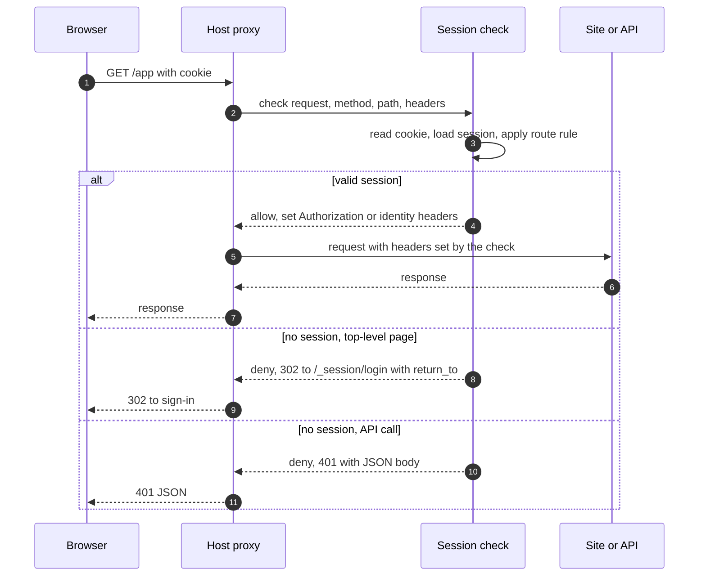
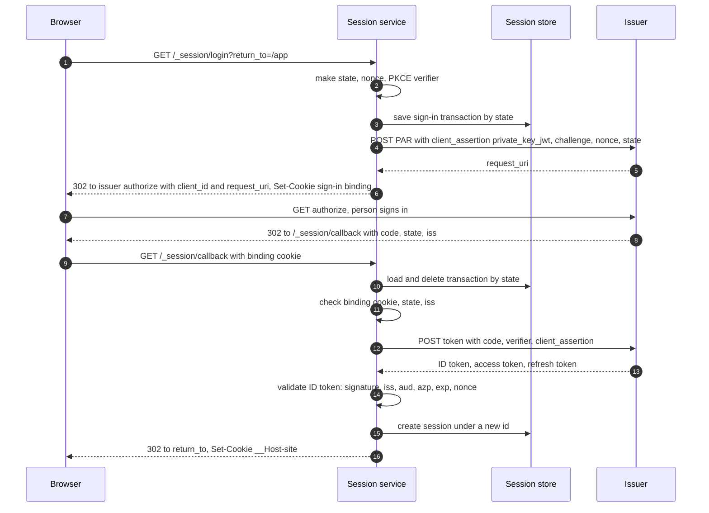
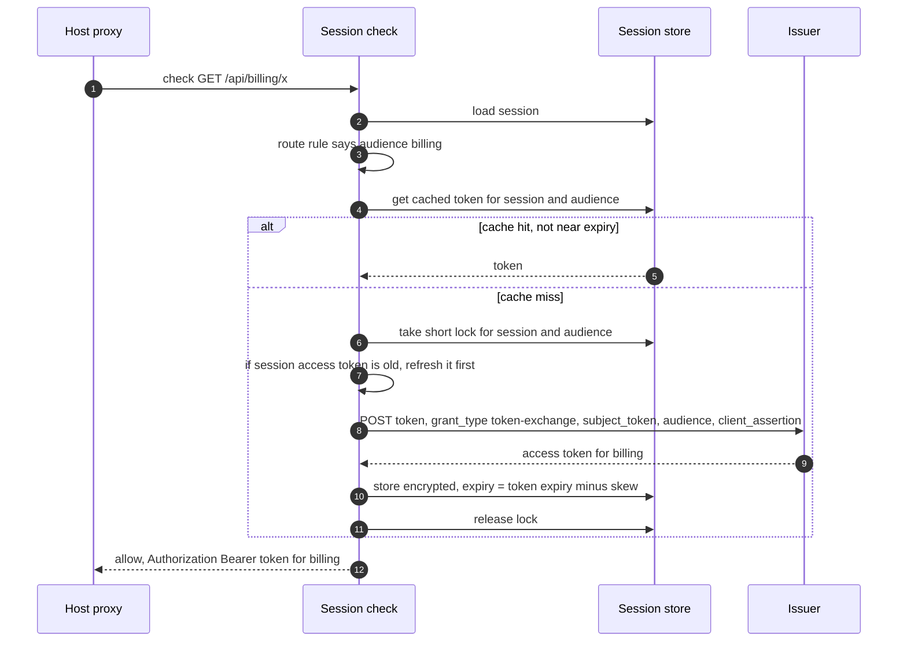
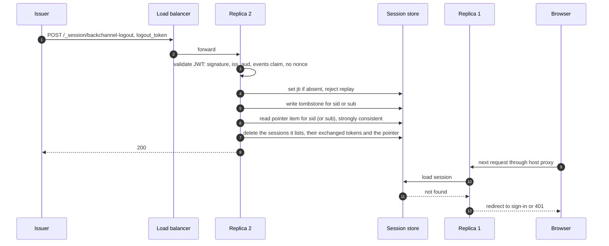

# Design of truvity/session

Status: design, 2026-11-18. Amended after the first spike (section 17, [findings](spike-2026-11-18.md)). The amendments are marked "coordinator's call 2026-11-18, for review" and wait for the maintainers. Prototype code exists only as a throwaway spike in [spike/](../spike/). Amended on 2026-11-20 by decision 0017: session is built on atoom (sections 9 and 16).

Decisions are recorded one by one in [docs/decisions](decisions/). This document puts them together and shows how the parts work.

## 1. Purpose

`session` is a relying-party component. After an issuer has signed a person in, `session` keeps the website's browser session on the server.

- The browser holds one opaque cookie. Tokens never reach the browser.
- The proxy in front of the site asks `session` before each request: may this pass, and with which headers?
- The issuer is sluis. Keycloak is used to build and test first.

What it replaces: the OIDC filter of Envoy Gateway, which keeps tokens in browser cookies.

What it does not replace: any part of the sluis issuer core. `session` is a client of the issuer, not a second issuer.

## 2. Goals and non-goals

| Goals | Non-goals |
| --- | --- |
| Server-side browser session for a website | Being an identity provider |
| One check core for every proxy | Authenticating API callers without a browser (the per-API door of sluis) |
| Per-API tokens, never one token valid everywhere | Authorisation policy beyond the route table (the API decides what the user may do) |
| Works behind Envoy Gateway, nginx and AWS API Gateway | Reading request bodies |
| Small, auditable, written in Go | Managing issuer clients or Keycloak realms |

## 3. Overview

```text
 browser  ->  host proxy  ->  site
                 |
                 +--  "may this pass?"  -->  session check  -->  session store
                                                  |
                                                  +--  sign-in, token exchange, logout  -->  issuer
```

One check core does the work. Adapters only translate between a proxy's protocol and the core.

| Piece | Job |
| --- | --- |
| Check core | Reads the cookie, loads the session, decides allow, redirect or 401, builds the headers |
| Adapters | Envoy external authorisation (HTTP and gRPC), nginx `auth_request`, AWS API Gateway Lambda authorizer |
| Sign-in handler | Login, callback, logout, back-channel logout, whoami |
| Exchange client | Gets and caches a token for each API audience (RFC 8693) |
| Ports | Go interfaces for the session store, keys and policy (section 9). First implementations: DynamoDB, key file and AWS KMS, the site file |
| In-path mode | The same service as a reverse proxy, for sites where one more hop is fine |

Libraries: `coreos/go-oidc`, `golang.org/x/oauth2`, `go-jose`. We write the glue, not the cryptography.

## 4. Deployment: external authorisation

The host proxy asks `session` before each request. `session` is not in the data path.



Rules of this mode:

- The proxy sends only headers. The check never sees the body.
- The proxy strips `Authorization`, `Cookie` and identity headers that came from the browser. The allow answer sets the real ones. The example configs ship this.
- The sign-in paths (`/_session/*`) are routed to the service without a check, because they run before a session exists.
- The check fails closed. If the store is down, the answer is 503, never allow. The check bounds every store call with its own timeout (1.5 s in the spike), and the proxy's timeout for the check is longer, so the check's 503 is the one the client sees. nginx shows it as 500 (see below).
- The check must see the same normalised path the proxy routes on. Each host example ships the settings for it (see the host notes below). *(After the spike; coordinator's call 2026-11-18, for review.)*

Hosts:

| Host | How it asks | Notes |
| --- | --- | --- |
| Envoy Gateway | `SecurityPolicy` with external authorisation. gRPC mode is preferred, HTTP mode is documented | See "Envoy notes" below |
| nginx | `auth_request` with `auth_request_set` | Self-hosted installs. See "nginx notes" below |
| AWS API Gateway | Lambda authorizer, for both the REST API and the HTTP API (payload 2.0). The docs default to the HTTP API | Cannot redirect, cannot set or remove headers, cannot send `Set-Cookie`. See "API Gateway notes" below. Where there is no cluster, the Lambda handler is the default |

*Envoy notes* (spike, coordinator's call 2026-11-18, for review):

- gRPC mode is preferred. The allow answer carries `headers` (overwrite) and `headers_to_remove`, so a browser-sent `Authorization` or `Cookie` is removed, not left empty. `Set-Cookie` goes in `response_headers_to_add` and may hold several cookies.
- HTTP mode works but cannot remove a header: the allow answer can only set it to an empty value, and the upstream then sees an empty `Authorization`. The HTTP example therefore adds `request_headers_to_remove` on the route, or the allow answer always sets every header it owns. `Set-Cookie` needs `allowed_client_headers_on_success`. A deny answer's `Location` and `Content-Type` need `allowed_client_headers`. A 503 from the check keeps its status but loses its body.
- The check sees only the headers the example lists in the top-level `allowed_headers` (`cookie`, `accept`, `sec-fetch-mode`, `sec-fetch-site`, `origin`). The older `authorization_request.allowed_headers` is deprecated in Envoy v1.34. Without `sec-fetch-mode` every navigation becomes a 401, so the conformance suite checks it.
- The connection manager sets `normalize_path: true`, `merge_slashes: true` and `path_with_escaped_slashes_action: REJECT_REQUEST`, so the check gets the path the router uses.
- The sign-in prefix is excluded with `ExtAuthzPerRoute` and `disabled: true`.
- If the check cannot be reached, Envoy answers with `status_on_error` (503) and `failure_mode_allow: false` stays.

*nginx notes* (spike, coordinator's call 2026-11-18, for review):

- `auth_request` accepts only 2xx, 401 and 403 from the check and turns any other status into a 500. It also forwards neither a 302 nor a body. The nginx adapter answers 401 with the markers `X-Session-Action` and `X-Session-Location`. A named location turns the marker into a 302 for top-level navigations, and nginx itself writes the JSON `login_required` body for everything else. The example carries both.
- Fail closed shows as 500 on nginx, not 503. The request is still refused.
- The check must be given the normalised path: `proxy_set_header X-Original-URI $uri$is_args$args`. With `$request_uri` the check saw `/assets/../private/x`, took it for the public `/assets/` prefix and allowed it without a session, while the upstream received the raw path (reproduced in the spike). `$uri` is decoded, so the example rejects encoded slashes.
- Identity headers, `Authorization` and `Cookie` are set from `auth_request_set` variables on every request. An empty variable makes nginx drop the header, so a browser-sent value cannot pass.
- `Set-Cookie` from `auth_request_set` carries only the first cookie.

*API Gateway notes* (spike, coordinator's call 2026-11-18, for review):

- Both handlers stay: the REST API `REQUEST` authorizer (also usable on HTTP API payload 1.0) and the HTTP API payload 2.0 authorizer with simple responses. The docs and examples default to the HTTP API. The HTTP API event carries the cookies in a separate `cookies` array; the handler joins them.
- "No session" is answered with the error `Unauthorized`, which API Gateway turns into a 401. A deny policy gives 403 on the REST API, which the browser helper would not read as "sign in".
- **Caching is configured, not assumed.** The REST API authorizer caches for 300 seconds when `authorizerResultTtlInSeconds` is not set (maximum 3600, 0 disables). The examples and the chart set it to 0 explicitly on both products, and a check in the examples tests for it. The HTTP API page does not state a default, so it is set to 0 as well. With caching on, a logout lags by the TTL (the cache key is the identity sources, such as the whole `Cookie` header). This keeps decision 0012 Q6 A true.
- The authorizer cannot change the request or the response. Only `principalId` and `context` reach the integration, as `$context.authorizer.<key>`. The browser's headers reach the integration unchanged, so stripping (S8) is the integration's parameter mapping, not the allow answer.
- The HTTP API reserves `Authorization` (and `Origin`, `Forwarded`, `X-Forwarded-*`, `Via`, among others) in parameter mapping, so it cannot be set or removed there. The per-API token travels in a non-reserved header, `X-Session-Token`, and the site must ignore a browser-sent `Authorization`.
- The sign-in paths go to the service over an HTTP integration, or to the same binary as a second Lambda handler (an HTTP API proxy integration, `Set-Cookie` lines in the response `cookies` array), for each install.
- Items from the AWS documentation that the spike did not run in a real account are listed in "Next steps".

The in-path mode is a plain reverse proxy that runs the same check, then forwards the request. It costs a hop, so it is for sites where that is fine.

## 5. Behaviour contract

These are the rules every host gets. They do not depend on the proxy.

| Id | Rule |
| --- | --- |
| S1 | Cookie `__Host-<site>`: opaque id, `Secure`, `HttpOnly`, `SameSite=Lax`, `Path=/`, no `Domain` |
| S2 | Sessions live on the server, encrypted, in DynamoDB on every shape. Each site has an idle and a maximum lifetime |
| S3 | Sign-in uses authorisation code with PKCE, always. PAR and `private_key_jwt` are used (issuers have them) |
| S4 | Page without session: redirect to sign-in. API call: JSON 401. The API Gateway authorizer cannot redirect, so it returns the error `Unauthorized` (401, never a deny policy) and the browser helper starts sign-in. nginx makes the redirect and the 401 body itself from a marker in the check's 401 |
| S5 | State-changing requests need CSRF protection: a custom header plus `Origin` and `Sec-Fetch-Site` checks. Headers only |
| S6 | Logout is a POST with CSRF, then the issuer's end-session. Back-channel logout deletes the session on all replicas |
| S8 | The browser's `Authorization`, cookies and identity headers are stripped. In external authorisation the host strips and the allow answer sets them. Envoy gRPC strips with `headers_to_remove`; Envoy HTTP and nginx set every owned header on every request (or the route removes them); on API Gateway the integration's parameter mapping strips, and the HTTP API cannot map `Authorization`, so the per-API token uses `X-Session-Token` |

(There is no S7. The ids follow the maintainers' list of decisions.)

### 5.1 Session record

| Field | Content |
| --- | --- |
| id | 256 random bits, only in the cookie. The store key is a keyed hash of it, so a store leak gives no usable cookie |
| subject, issuer, `sid` | From the ID token. Indexed for back-channel logout |
| tokens | The sign-in access token and refresh token |
| exchanged tokens | One entry per audience, see section 7 |
| created, last seen, expires | Idle and maximum lifetime. `created` is in milliseconds, for the logout comparison (section 8) |

The record is encrypted with AES-256-GCM. The session id is the associated data. The data keys come from the key port, so they can be rotated.

A new id is issued at sign-in, so a session id set before sign-in is never reused (no fixation).

Idle time is refreshed at most once a minute, to keep writes down. The default lifetimes are suggestions: 30 minutes idle, 8 hours maximum. Each site sets its own. These defaults were accepted on 2026-11-18 (decision 0011).

### 5.2 Paths

`session` owns one prefix on every site, `/_session/` by default.

| Path | Method | Purpose |
| --- | --- | --- |
| `/_session/login` | GET | Start sign-in. `return_to` must be a relative path of the same site |
| `/_session/callback` | GET | Receive the code from the issuer |
| `/_session/logout` | POST | End the session. Needs CSRF headers |
| `/_session/backchannel-logout` | POST | Called by the issuer |
| `/_session/whoami` | GET | JSON: subject, name, groups, session expiry |
| `/_session/jwks` | GET | Public keys of the service, for apps that verify the signed identity header |

### 5.3 Unauthenticated requests

A route says what to do without a session: `redirect` or `401`. The default is `redirect` for a top-level navigation (`GET`, `Sec-Fetch-Mode: navigate`, `Accept` includes `text/html`) and `401` for everything else. The 401 body is JSON with `error: login_required` and a `login_url`.

## 6. Sign-in



Notes:

- The sign-in transaction is short-lived (a few minutes) and used once.
- A short-lived binding cookie ties the transaction to the browser that started it.
- The callback checks the `iss` parameter (RFC 9207) against the configured issuer.
- `return_to` is stored in the transaction, never taken from the callback URL.
- PAR keeps the request parameters off the browser's URL bar. `private_key_jwt` means the service holds no shared secret.

## 7. Per-API tokens (RFC 8693)

A route can name an API audience. The check exchanges the session's token for a token that is valid only for that API, and puts it in the allow answer.



Rules:

- The cache key is session id, audience and scope. Entries expire with the token, minus a skew.
- A lock (single flight) stops many parallel requests from exchanging at once.
- Cache entries are deleted with the session, at logout and at back-channel logout.
- If the exchange is refused, the answer is 403 for that route. The session stays.
- Option C is an opt-in per route: a signed identity header with user and groups, for apps that cannot handle tokens. The service signs it through the key port and publishes the public keys at `/_session/jwks`. It is short-lived, about a minute.
- Forwarding the session token itself (option B) is rejected, because one token would be valid on every API.

## 8. Logout

The person's own logout is simple: a POST with CSRF headers deletes the session, clears the cookie and redirects to the issuer's end-session.

Logout started at the issuer arrives by back-channel logout. The issuer posts to any replica. All replicas share the store, so deleting there is enough.



Design consequences:

- Replicas keep no session state. The next check on any replica sees the deletion at once.
- For this reason the first version has no local session cache (decision 0012). The spike measured DynamoDB Local only (0.2 to 0.5 ms per call); real DynamoDB latency is still to be measured ("Next steps").
- There is no secondary index. Pointer items hold the session keys for each `sid` and each subject (decision 0013, coordinator's call 2026-11-18, for review). A pointer item is written in the same transaction as the session. The logout reads it with a strongly consistent GetItem, so it cannot miss a session committed before it.
- One race is left: a logout that arrives before the sign-in has finished. The callback closes it with one tombstone read at session creation (never on each check). If a tombstone newer than the start of the sign-in exists, the callback ends the session it just made.
- Tombstones are written by every back-channel logout, by `sid`, or by subject when the token has no `sid`, and live as long as the maximum session lifetime.

## 9. Ports and blocks: store, keys, policy, audit

Since 2026-11-20 the core is built on [truvity/atoom](https://github.com/truvity/atoom) (decision 0017, which supersedes 0009). session has no port interfaces of its own.

| Need | From atoom | First implementation |
| --- | --- | --- |
| Sessions and their items | `store` port | `store/dynamodb`; any driver that passes the store kit (PostgreSQL, Valkey) |
| Signing, JWKS, sealing | `key` port and the `keyring` block | `key/awskms`, `key/software` (a key file) |
| Site file and policy bundle | `source` port | `source/file` (Go) |
| Who may reach a route | `cedar-go` in-process, loaded by atoom's Cedar loader | The signed policy bundle |
| Audit events | atoom's emitter and `transport` port | to the sluis audit writer of the environment |

Every port is called through its generated ConnectRPC client, with the driver mounted in-process. Cedar is the one exception: a library by design (0017).

### Session store (DynamoDB first)

Sessions live in DynamoDB on every shape: Kubernetes, nginx and API Gateway installs alike (decision 0010).

| Need | How |
| --- | --- |
| Expiry | A TTL attribute, plus an explicit expiry check on read, because TTL deletion is lazy |
| Idle refresh | A conditional update, at most once a minute for each session |
| Exchange lock | A conditional write with a short expiry, one item for each session and audience |
| Back-channel logout | Pointer items per `sid` and per subject, written in the session-creation transaction, read with a strongly consistent GetItem. A tombstone read once at creation. No secondary index (decision 0013) |
| Token cache | Items under the session, deleted with it |
| Timeouts | Every store call has a timeout shorter than the proxy's timeout for the check, so a slow store is a down store and the check answers 503 |

Rules:

- The check reads the session item for each request, and nothing else: one strongly consistent GetItem, which is 1 read unit for an item under 4 KB. The spike measured latency on DynamoDB Local only. Reading tombstones on each request was tested and rejected: it costs 3 read units instead of 1 (decision 0013).
- The store port takes a timeout for each call (decision 0016).
- Reads of the session item are strongly consistent, so a logout is seen at once.
- A memory store exists for tests only and refuses to start in production mode.
- The Helm chart takes a table name and a cloud identity (a service account role). It does not run a store.

### Keys

The key port covers three jobs: the `private_key_jwt` assertions, the signed identity header, and the data keys that encrypt session records. The key file is the simple start and works with Keycloak. AWS KMS keeps the key from ever leaving it. The JWKS of the service is published at `/_session/jwks`.

### Policy

The policy port answers, for a request on a route: is a session needed, which API audience's token does the route need, and may this person reach it. At first the answer comes from the route table of the site file (section 10).

## 10. Site configuration

One file per site. The schema is part of the repo, and `session check` validates it (the generator turns it into proxy config).

```yaml
site: docs
host: docs.example.com
issuer: https://issuer.example.com
client:
  id: session-docs
  auth: private_key_jwt
  key_file: /run/secrets/docs-client-key.pem
scopes: [openid, profile, groups]
session:
  idle: 30m
  max: 8h
routes:
  - match: { prefix: /assets/ }
    mode: public
  - match: { prefix: /api/billing/ }
    mode: exchange
    audience: https://billing.example.com
  - match: { prefix: /api/ }
    mode: identity-header
  - match: { prefix: / }
    mode: session
```

| Route mode | Allow answer carries |
| --- | --- |
| `public` | Nothing. No session needed |
| `session` | Only that the session is valid, plus the cookie-stripped `Cookie` header |
| `exchange` | `Authorization: Bearer` with the token for the audience |
| `identity-header` | A signed identity header (option C) |

Routes are matched in order. The first match wins. The check matches on the normalised path, and the host proxy must route on the same normalised path (see the threat model).

## 11. Repository contents

| In the repo | Path (planned) |
| --- | --- |
| Check service, image and Helm chart: 2 replicas, Service, NetworkPolicy, DynamoDB table name and cloud identity | `cmd/session`, `charts/session` |
| Lambda authorizer package, and the same binary as a second Lambda handler for the sign-in paths | `cmd/authorizer-lambda` |
| Example host configs: Envoy `SecurityPolicy`, nginx, API Gateway | `examples/` |
| Site config schema, `session check` validator and generator | `schema/`, `cmd/session` |
| Browser helper in TypeScript: `apiFetch` (401 gives a re-login hint), `whoami`, `signOut` as POST with CSRF | `web/` |
| Conformance suite: headless browser, run in CI against a test sluis and a test Keycloak | `conformance/` |
| Docs: site file reference, "put a site behind it" guide, threat model | `docs/` |

Not in the repo:

- The per-API door for API callers. That is the sluis resource-proxy sidecar.
- Keycloak realm configuration.
- Envoy routing and cluster configuration. Those live in the platform's own repositories.

## 12. Issuers and the first checks

| Issuer | Role |
| --- | --- |
| sluis v2 | The target, once its FAPI work lands (PAR, `private_key_jwt`) |
| Keycloak | Has PAR and `private_key_jwt` now. Used to build and test first |

Check E8 (answered by the first spike, decision 0007, coordinator's call 2026-11-18, for review): does the token exchange of sluis v1 accept the proxy's sign-in token? **No.** v1 accepts a sign-in access token only from a `public` client that declares `sign_in_exchange`, and `session` is a confidential `private_key_jwt` client. v1 also has no PAR and no `private_key_jwt`. Sites on v1 wait for v2. A public-client workaround is rejected. What `session` needs from v2: its token exchange accepts the access token of a confidential `private_key_jwt` client as subject token, presented by the same client.

## 13. Threat model (summary)

The full model goes into `docs/threat-model.md` with the first code.

| Threat | Answer |
| --- | --- |
| Token theft from the browser | Tokens never leave the server. The cookie is `HttpOnly` and `__Host-` |
| Stolen store contents | Session records are encrypted. The store key is a keyed hash of the id |
| CSRF | `SameSite=Lax`, a custom header, `Origin` and `Sec-Fetch-Site` checks (S5) |
| Session fixation | New id at sign-in |
| Open redirect | `return_to` must be a relative path, kept server-side |
| Login CSRF and code injection | State plus binding cookie, PKCE, `iss` check |
| Header spoofing | The host strips browser headers, the allow answer sets them (S8). The examples ship this |
| Path confusion between proxy and check | Both use the normalised path. Reproduced in the spike on nginx with `$request_uri`. The conformance suite sends dot-segment, encoded-dot and merged-slash paths to every host, and the examples ship Envoy `normalize_path`, `merge_slashes` and `path_with_escaped_slashes_action`, and nginx `$uri$is_args$args` with encoded slashes rejected |
| Replay of logout tokens | `jti` stored until the token expires |
| Store outage | Fail closed |
| Token blast radius | One token per API audience. No token valid everywhere |
| Cross-site embedding | `SameSite=Lax` and no `Domain`. Sites are separate hosts |

## 14. Testing

The conformance suite drives a headless browser through the real flows: sign-in, an API call with a 401 and re-login, CSRF refusal, logout, back-channel logout across two replicas, session expiry, and header stripping. It runs in CI against a test sluis and a test Keycloak, with each host adapter in turn. The dot-segment cases and the header-stripping cases run on every host. It uses TLS or a real browser, not a Go cookie jar over plain HTTP (a jar does not send `Secure` cookies over HTTP).

## 15. Decisions after review

On 2026-11-18 the maintainers accepted the defaults of this document and answered the questions that came with it. They are recorded in decisions 0009 to 0012. In short:

| Topic | Decided | Record |
| --- | --- | --- |
| Ports shaped like sluis v2 building blocks | Yes, own interfaces now, switch to the sluis blocks at alpha.2 | 0009 |
| Session store | DynamoDB on every shape. Valkey is dropped | 0010 |
| Defaults: `/_session/` paths, keyed-hash store key, AES-256-GCM, 30 min idle and 8 h maximum, YAML site file, fail closed with 503, redirect for top-level navigations and 401 otherwise | Accepted as written | 0011 |
| API Gateway sign-in handlers | HTTP integration or a second Lambda handler for each install, default Lambda where there is no cluster | 0012 |
| Local session cache | None at first | 0012 |
| `private_key_jwt` key and identity header key | Through the key port: key file and AWS KMS. JWKS published | 0012 |
| Sites and hosts | One site per host | 0012 |
| Authorizer caching | Off by default (amended after the spike: set to 0 explicitly, because the REST API default is 300 s) | 0012, 0015 |
| Subject token freshness | Refresh token stored, refreshed under a lock | 0012 |
| Envoy adapters | HTTP and gRPC from the start (amended after the spike: gRPC preferred) | 0012, 0016 |
| Refused exchange | JSON 403 for API routes, error page for page routes | 0012 |

## 16. Next steps

Revised on 2026-11-20 after atoom 0.2.0 (decision 0017).

1. Spike, about a week. **Done on 2026-11-18**, see [the findings](spike-2026-11-18.md) and section 17.
2. Decision 0017: session on atoom. **Done on 2026-11-20.**
3. Fit spike, about a day: the check core on atoom 0.2.0's `store/dynamodb` and `key` drivers mounted in-process; authorizer events through the Lambda Web Adapter; the same short check in a real AWS account that the first spike could not make (below).
4. Check core, sign-in handler and Envoy adapters against Keycloak, about four to five days. The broker rules and the browser library come from the Group IDP reference stand where they fit.
5. nginx adapter, AWS KMS, the exchange client and the conformance suite (with the stand's scenarios and Keycloak findings), about three to four days. Needs from atoom: `keyring`, the Go `source/file` driver, the Cedar loader with its decision test set, the audit emitter in Go.
6. First version for the first internal sites.
7. Lambda: the authorizer and the sign-in handler behind the Lambda Web Adapter, HTTP API first, then REST API.
8. sluis v2 as an issuer once PAR and `private_key_jwt` land there. Sites on sluis v1 wait for v2 (decision 0007).

### Decided after the spike (coordinator's call 2026-11-18, for review)

| Question | Decided | Roads not taken | Record |
| --- | --- | --- | --- |
| Q10. What do installs without AWS use for sessions? | A: every install uses a DynamoDB table it can reach. Another store only when a real site needs it | B: a DynamoDB-compatible local service. C: a relational database behind the store port. Both wait for a real site | 0014 |
| Q11. How do we keep logout correct without a lagging index? | C: pointer items written in the session-creation transaction, a strongly consistent GetItem at logout, one tombstone read at creation | B: tombstone read on each check (3 read units a check instead of 1). A: accept the gap (a missed session lives until idle or maximum time) | 0013 |

### Open for the maintainers

Not decided. The spike could not settle them without a real AWS account.

1. A short check in a real AWS account of the API Gateway items that were taken from the documentation: the HTTP API status for `isAuthorized: false`, the HTTP API default cache TTL, and integration parameter mapping with `$context.authorizer.*` (including the non-reserved token header).
2. Real DynamoDB latency from the target region for the one strongly consistent read of each check, to confirm or reverse "no local cache" (decision 0012 Q2). The spike measured DynamoDB Local only.
3. Whether the sluis v2 token exchange takes the access token of a confidential `private_key_jwt` client as subject token (a request to the sluis v2 owners, filed by the coordinator).

## 17. Changes after the first spike

All of these are coordinator's call 2026-11-18, for review. Details and evidence are in [the findings](spike-2026-11-18.md).

| Change | Where | Record |
| --- | --- | --- |
| Envoy: prefer gRPC mode, document HTTP mode with `request_headers_to_remove`, top-level `allowed_headers`, path normalisation, per-route disable | Section 4 | 0016 |
| nginx: 401 plus marker pattern, `$uri$is_args$args`, encoded slashes rejected, fail-closed shows as 500 | Section 4 | 0016 |
| API Gateway: both handlers, HTTP API is the default, authorizer TTL 0 set explicitly, `Unauthorized` error for no session, stripping by integration mapping, `X-Session-Token` for the per-API token | Sections 4 and 5 (S4, S8) | 0015 |
| Logout race: pointer items, no secondary index, tombstone once at creation, `created` in milliseconds | Sections 5.1, 8, 9 | 0013 |
| Installs without AWS: DynamoDB table everywhere | Section 16 | 0014 |
| Store port: a timeout for each call, shorter than the proxy's | Sections 4, 9 | 0016 |
| Path confusion: conformance dot-segment cases on every host, TLS or a real browser in the suite | Sections 13, 14 | 0016 |
| E8 answered: no | Section 12 | 0007 |
| Ports, stores, sealing, policy, audit, Lambda packaging and the reference stand, after atoom 0.2.0 (maintainer decisions 2026-11-20) | Sections 9, 16 | 0017 |
