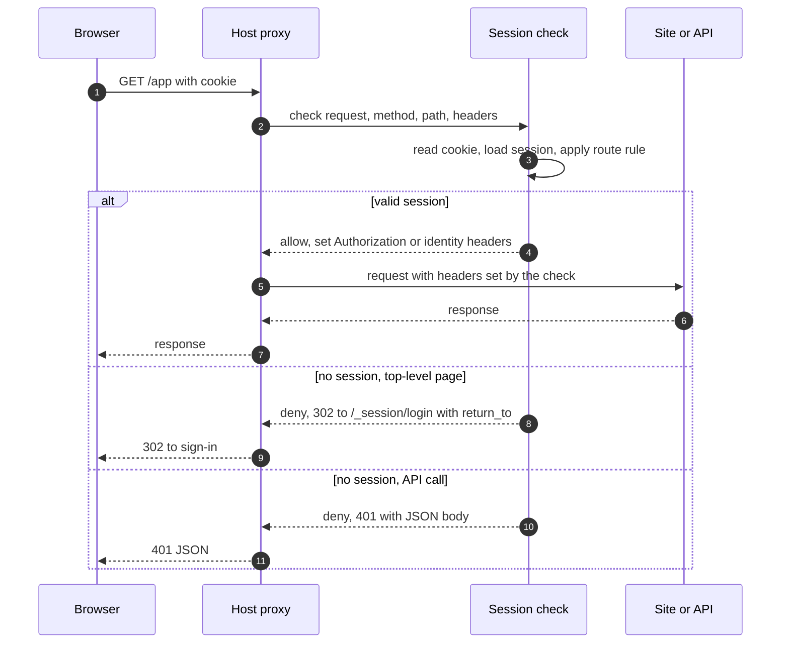
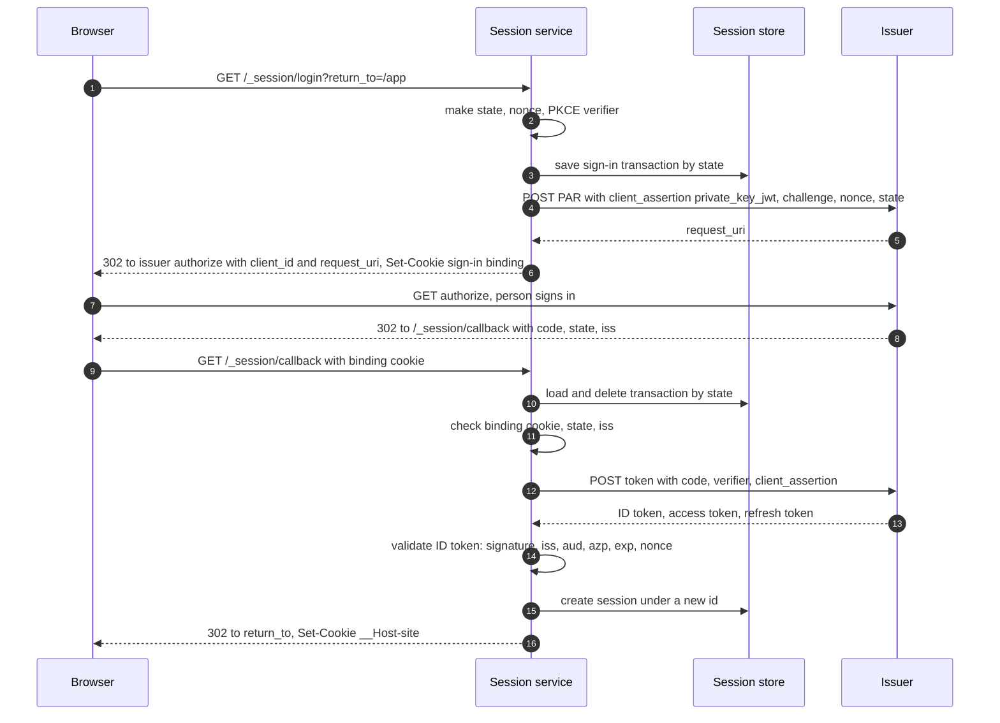
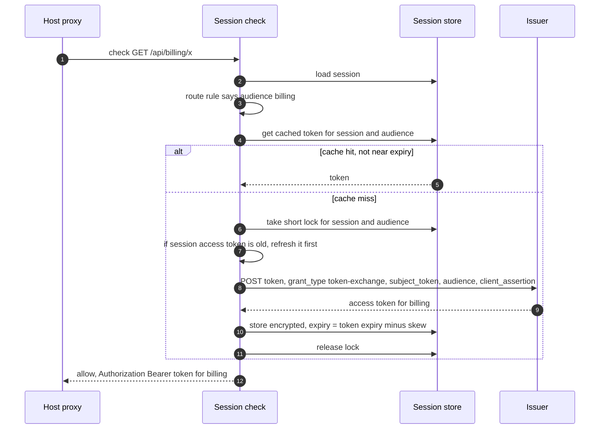
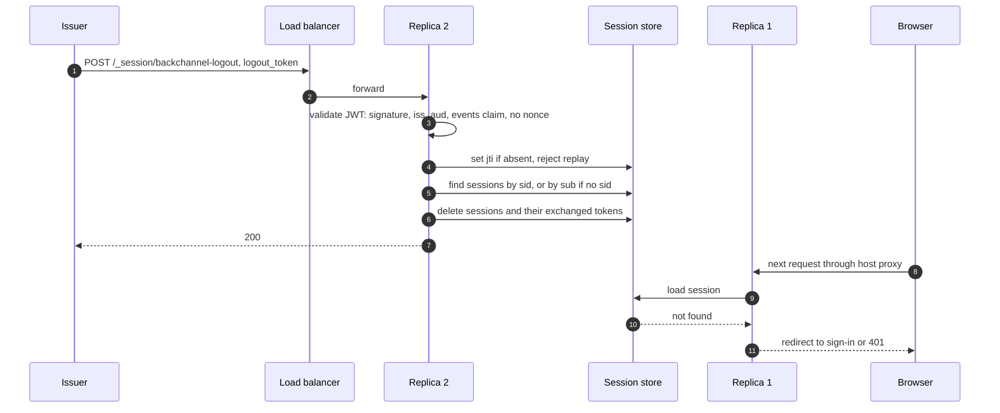

# Design of truvity/session

Status: design, 2026-11-18. No code yet.

Decisions are recorded one by one in [docs/decisions](decisions/). This document puts them together and shows how the parts work.

## 1. Purpose

`session` is a relying-party component. After an issuer has signed a person in, `session` keeps the website's browser session on the server.

- The browser holds one opaque cookie. Tokens never reach the browser.
- The proxy in front of the site asks `session` before each request: may this pass, and with which headers?
- The issuer is sluis. Keycloak is used to build and test first.

What it replaces: the OIDC filter of Envoy Gateway, which keeps tokens in browser cookies.

What it does not replace: any part of the sluis issuer core. `session` is a client of the issuer, not a second issuer.

## 2. Goals and non-goals

| Goals | Non-goals |
| --- | --- |
| Server-side browser session for a website | Being an identity provider |
| One check core for every proxy | Authenticating API callers without a browser (the per-API door of sluis) |
| Per-API tokens, never one token valid everywhere | Authorisation policy beyond the route table (the API decides what the user may do) |
| Works behind Envoy Gateway, nginx and AWS API Gateway | Reading request bodies |
| Small, auditable, written in Go | Managing issuer clients or Keycloak realms |

## 3. Overview

```text
 browser  ->  host proxy  ->  site
                 |
                 +--  "may this pass?"  -->  session check  -->  session store
                                                  |
                                                  +--  sign-in, token exchange, logout  -->  issuer
```

One check core does the work. Adapters only translate between a proxy's protocol and the core.

| Piece | Job |
| --- | --- |
| Check core | Reads the cookie, loads the session, decides allow, redirect or 401, builds the headers |
| Adapters | Envoy external authorisation (HTTP and gRPC), nginx `auth_request`, AWS API Gateway Lambda authorizer |
| Sign-in handler | Login, callback, logout, back-channel logout, whoami |
| Exchange client | Gets and caches a token for each API audience (RFC 8693) |
| Session store | Valkey, or DynamoDB for API Gateway installs |
| In-path mode | The same service as a reverse proxy, for sites where one more hop is fine |

Libraries: `coreos/go-oidc`, `golang.org/x/oauth2`, `go-jose`. We write the glue, not the cryptography.

## 4. Deployment: external authorisation

The host proxy asks `session` before each request. `session` is not in the data path.



Rules of this mode:

- The proxy sends only headers. The check never sees the body.
- The proxy strips `Authorization`, `Cookie` and identity headers that came from the browser. The allow answer sets the real ones. The example configs ship this.
- The sign-in paths (`/_session/*`) are routed to the service without a check, because they run before a session exists.
- The check fails closed. If the store is down, the answer is 503, never allow.

Hosts:

| Host | How it asks | Notes |
| --- | --- | --- |
| Envoy Gateway | `SecurityPolicy` with external authorisation, HTTP or gRPC | Allow headers set on the upstream request, deny answer passed to the browser |
| nginx | `auth_request` with `auth_request_set` | Self-hosted installs |
| AWS API Gateway | Lambda authorizer | Cannot redirect. It returns 401 and the browser helper starts sign-in |

The in-path mode is a plain reverse proxy that runs the same check, then forwards the request. It costs a hop, so it is for sites where that is fine.

## 5. Behaviour contract

These are the rules every host gets. They do not depend on the proxy.

| Id | Rule |
| --- | --- |
| S1 | Cookie `__Host-<site>`: opaque id, `Secure`, `HttpOnly`, `SameSite=Lax`, `Path=/`, no `Domain` |
| S2 | Sessions live on the server, encrypted, in Valkey (DynamoDB for API Gateway installs). Each site has an idle and a maximum lifetime |
| S3 | Sign-in uses authorisation code with PKCE, always. PAR and `private_key_jwt` are used (issuers have them) |
| S4 | Page without session: redirect to sign-in. API call: JSON 401. The API Gateway authorizer cannot redirect, so it returns 401 and the browser helper starts sign-in |
| S5 | State-changing requests need CSRF protection: a custom header plus `Origin` and `Sec-Fetch-Site` checks. Headers only |
| S6 | Logout is a POST with CSRF, then the issuer's end-session. Back-channel logout deletes the session on all replicas |
| S8 | The browser's `Authorization`, cookies and identity headers are stripped. In external authorisation the host strips and the allow answer sets them |

(There is no S7. The ids follow the maintainers' list of decisions.)

### 5.1 Session record

| Field | Content |
| --- | --- |
| id | 256 random bits, only in the cookie. The store key is a keyed hash of it, so a store leak gives no usable cookie |
| subject, issuer, `sid` | From the ID token. Indexed for back-channel logout |
| tokens | The sign-in access token and refresh token |
| exchanged tokens | One entry per audience, see section 7 |
| created, last seen, expires | Idle and maximum lifetime |

The record is encrypted with AES-256-GCM. The session id is the associated data. Keys come from a key ring, so they can be rotated.

A new id is issued at sign-in, so a session id set before sign-in is never reused (no fixation).

Idle time is refreshed at most once a minute, to keep writes down. The default lifetimes are suggestions: 30 minutes idle, 8 hours maximum. Each site sets its own.

### 5.2 Paths

`session` owns one prefix on every site, `/_session/` by default.

| Path | Method | Purpose |
| --- | --- | --- |
| `/_session/login` | GET | Start sign-in. `return_to` must be a relative path of the same site |
| `/_session/callback` | GET | Receive the code from the issuer |
| `/_session/logout` | POST | End the session. Needs CSRF headers |
| `/_session/backchannel-logout` | POST | Called by the issuer |
| `/_session/whoami` | GET | JSON: subject, name, groups, session expiry |

### 5.3 Unauthenticated requests

A route says what to do without a session: `redirect` or `401`. The default is `redirect` for a top-level navigation (`GET`, `Sec-Fetch-Mode: navigate`, `Accept` includes `text/html`) and `401` for everything else. The 401 body is JSON with `error: login_required` and a `login_url`.

## 6. Sign-in



Notes:

- The sign-in transaction is short-lived (a few minutes) and used once.
- A short-lived binding cookie ties the transaction to the browser that started it.
- The callback checks the `iss` parameter (RFC 9207) against the configured issuer.
- `return_to` is stored in the transaction, never taken from the callback URL.
- PAR keeps the request parameters off the browser's URL bar. `private_key_jwt` means the service holds no shared secret.

## 7. Per-API tokens (RFC 8693)

A route can name an API audience. The check exchanges the session's token for a token that is valid only for that API, and puts it in the allow answer.



Rules:

- The cache key is session id, audience and scope. Entries expire with the token, minus a skew.
- A lock (single flight) stops many parallel requests from exchanging at once.
- Cache entries are deleted with the session, at logout and at back-channel logout.
- If the exchange is refused, the answer is 403 for that route. The session stays.
- Option C is an opt-in per route: a signed identity header with user and groups, for apps that cannot handle tokens. The service signs it with its own key and publishes the public key. It is short-lived.
- Forwarding the session token itself (option B) is rejected, because one token would be valid on every API.

## 8. Logout

The person's own logout is simple: a POST with CSRF headers deletes the session, clears the cookie and redirects to the issuer's end-session.

Logout started at the issuer arrives by back-channel logout. The issuer posts to any replica. All replicas share the store, so deleting there is enough.



Design consequences:

- Replicas keep no session state. The next check on any replica sees the deletion at once.
- For this reason the first version has no local session cache (see open question Q2).
- With DynamoDB the same index is a secondary index on `sid` and `sub`.

## 9. Session store

| Store | Used by | Notes |
| --- | --- | --- |
| Valkey | Kubernetes and self-hosted installs | HA, authentication and TLS are required. Keys have TTLs. Indexes for `sid` and `sub` are sets |
| DynamoDB | API Gateway installs | TTL attribute, conditional writes for the locks, secondary index for logout |

One small store interface, two backends. A memory store exists for tests only and refuses to start in production mode.

## 10. Site configuration

One file per site. The schema is part of the repo, and `session check` validates it (the generator turns it into proxy config).

```yaml
site: docs
host: docs.example.com
issuer: https://issuer.example.com
client:
  id: session-docs
  auth: private_key_jwt
  key_file: /run/secrets/docs-client-key.pem
scopes: [openid, profile, groups]
session:
  idle: 30m
  max: 8h
routes:
  - match: { prefix: /assets/ }
    mode: public
  - match: { prefix: /api/billing/ }
    mode: exchange
    audience: https://billing.example.com
  - match: { prefix: /api/ }
    mode: identity-header
  - match: { prefix: / }
    mode: session
```

| Route mode | Allow answer carries |
| --- | --- |
| `public` | Nothing. No session needed |
| `session` | Only that the session is valid, plus the cookie-stripped `Cookie` header |
| `exchange` | `Authorization: Bearer` with the token for the audience |
| `identity-header` | A signed identity header (option C) |

Routes are matched in order. The first match wins. The check matches on the normalised path, and the host proxy must route on the same normalised path (see the threat model).

## 11. Repository contents

| In the repo | Path (planned) |
| --- | --- |
| Check service, image and Helm chart: 2 replicas, Service, NetworkPolicy, Valkey connection with HA, auth and TLS | `cmd/session`, `charts/session` |
| Lambda authorizer package | `cmd/authorizer-lambda` |
| Example host configs: Envoy `SecurityPolicy`, nginx, API Gateway | `examples/` |
| Site config schema, `session check` validator and generator | `schema/`, `cmd/session` |
| Browser helper in TypeScript: `apiFetch` (401 gives a re-login hint), `whoami`, `signOut` as POST with CSRF | `web/` |
| Conformance suite: headless browser, run in CI against a test sluis and a test Keycloak | `conformance/` |
| Docs: site file reference, "put a site behind it" guide, threat model | `docs/` |

Not in the repo:

- The per-API door for API callers. That is the sluis resource-proxy sidecar.
- Keycloak realm configuration.
- Envoy routing and cluster configuration. Those live in the platform's own repositories.

## 12. Issuers and the first checks

| Issuer | Role |
| --- | --- |
| sluis v2 | The target, once its FAPI work lands (PAR, `private_key_jwt`) |
| Keycloak | Has PAR and `private_key_jwt` now. Used to build and test first |

Check E8, in the first spike: does the token exchange of sluis v1 accept the proxy's sign-in token? If yes, sites on v1 can use `session` before the switch. If no, they wait.

## 13. Threat model (summary)

The full model goes into `docs/threat-model.md` with the first code.

| Threat | Answer |
| --- | --- |
| Token theft from the browser | Tokens never leave the server. The cookie is `HttpOnly` and `__Host-` |
| Stolen store contents | Session records are encrypted. The store key is a keyed hash of the id |
| CSRF | `SameSite=Lax`, a custom header, `Origin` and `Sec-Fetch-Site` checks (S5) |
| Session fixation | New id at sign-in |
| Open redirect | `return_to` must be a relative path, kept server-side |
| Login CSRF and code injection | State plus binding cookie, PKCE, `iss` check |
| Header spoofing | The host strips browser headers, the allow answer sets them (S8). The examples ship this |
| Path confusion between proxy and check | Both use the normalised path. A conformance test sends encoded and dot-segment paths |
| Replay of logout tokens | `jti` stored until the token expires |
| Store outage | Fail closed |
| Token blast radius | One token per API audience. No token valid everywhere |
| Cross-site embedding | `SameSite=Lax` and no `Domain`. Sites are separate hosts |

## 14. Testing

The conformance suite drives a headless browser through the real flows: sign-in, an API call with a 401 and re-login, CSRF refusal, logout, back-channel logout across two replicas, session expiry, and header stripping. It runs in CI against a test sluis and a test Keycloak, with each host adapter in turn.

## 15. Next steps

1. Spike, about a week:
   - Envoy and nginx check paths: headers set, `Cookie` rewrite, deny answers, cookie `Set-Cookie` on refresh.
   - The Lambda authorizer: response shape, how identity reaches the integration, caching and its effect on logout.
   - The E8 check: sluis v1 token exchange with the proxy's sign-in token.
2. Build the check core, the Valkey store, the sign-in handler and the Envoy adapter against Keycloak.
3. Add the nginx adapter, the exchange client and the conformance suite.
4. First version for the first internal sites.
5. DynamoDB store and Lambda authorizer.
6. Move to sluis v2 when PAR and `private_key_jwt` land.

### Open questions

Each has options and a recommendation. The maintainers decide.

**Q1. How do API Gateway installs run sign-in and callback?** An authorizer cannot serve pages.

| Option | Meaning |
| --- | --- |
| A | Route `/_session/*` to the service over an HTTP integration |
| B | Ship the same binary as a second Lambda handler for these paths |
| C | Both, chosen per install |

Recommendation: C, with B as the default for Lambda-shape sites that have no cluster to reach. Same code, two entry points.

**Q2. Should a replica cache sessions locally?**

| Option | Meaning |
| --- | --- |
| A | No cache. One store read per request |
| B | Short cache (a few seconds), cleared by pub/sub on logout |
| C | Short cache, no invalidation. Logout lags by the cache time |

Recommendation: A for the first version. Measure the store latency in the spike. Add B only if the numbers need it.

**Q3. Where does the `private_key_jwt` key live?**

| Option | Meaning |
| --- | --- |
| A | A mounted secret file, rotated by the platform |
| B | A cloud KMS signs each assertion, the key never leaves it |
| C | Both, behind one signer interface |

Recommendation: C. Start with A (simple, works with Keycloak), add B for the Lambda and for sluis v2.

**Q4. How is the signed identity header (option C of E4) signed and verified?**

| Option | Meaning |
| --- | --- |
| A | The service's own key, public key published at `/_session/jwks`, lifetime about a minute |
| B | A token exchanged from the issuer for the app's audience, as in `exchange` mode |
| C | HMAC with a secret shared with the app |

Recommendation: A. B is already the `exchange` mode, and C makes every app a signer.

**Q5. One site per host, or several sites on a host?** The `__Host-` prefix forces `Path=/`, so two sites on one host would share one cookie.

| Option | Meaning |
| --- | --- |
| A | One site per host only |
| B | Allow path-based sites with a `__Secure-` cookie and a `Path` attribute |

Recommendation: A. It keeps the cookie rules strict. Use B only if a real site needs it.

**Q6. Should the API Gateway authorizer cache its answers?** A cache means fewer Lambda calls but a slower logout.

| Option | Meaning |
| --- | --- |
| A | Cache off. Every request calls the authorizer |
| B | Cache for a short time (up to 10 seconds), opt-in per site |
| C | Cache for minutes |

Recommendation: A by default, B as opt-in with the logout lag written in the docs. Not C.

**Q7. How is the sign-in token kept fresh for exchange?** The exchange needs a valid subject token, and access tokens are short.

| Option | Meaning |
| --- | --- |
| A | Store the refresh token and refresh under a lock. End the session if refresh fails |
| B | No refresh. The session lasts as long as the first access token |
| C | Ask the issuer to accept the ID token as subject token |

Recommendation: A. B gives short sessions and C depends on the issuer. Rotation of refresh tokens is why the lock matters.

**Q8. Which Envoy adapter comes first, HTTP or gRPC?** The nginx adapter and Envoy's HTTP mode share one handler.

| Option | Meaning |
| --- | --- |
| A | HTTP only in the first version |
| B | HTTP and gRPC together |

Recommendation: A. Measure both in the spike. Add gRPC if it saves latency or header size.

**Q9. What does a user see when the exchange is refused?** The route returns 403, but a page route has no good place for it.

| Option | Meaning |
| --- | --- |
| A | JSON 403 for API routes, a plain error page for page routes |
| B | Always JSON, the front end decides |

Recommendation: A, with the error page template set per site.
