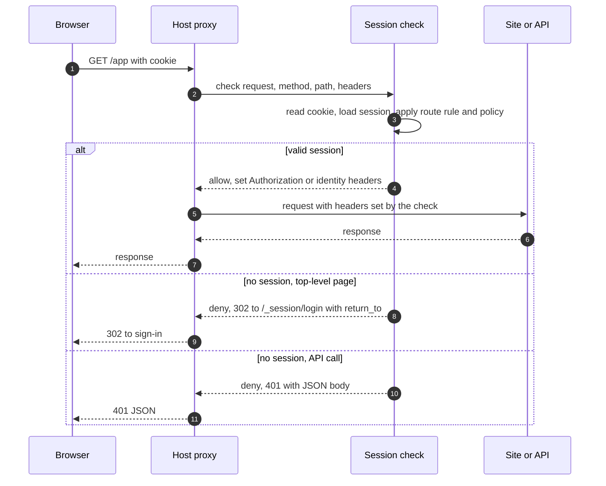
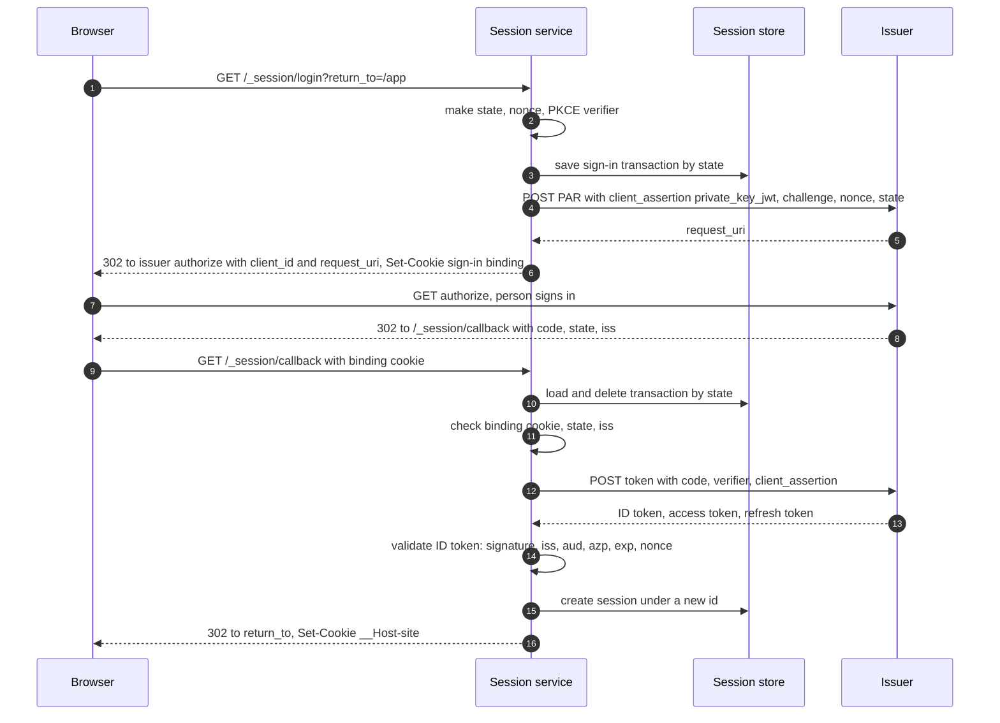
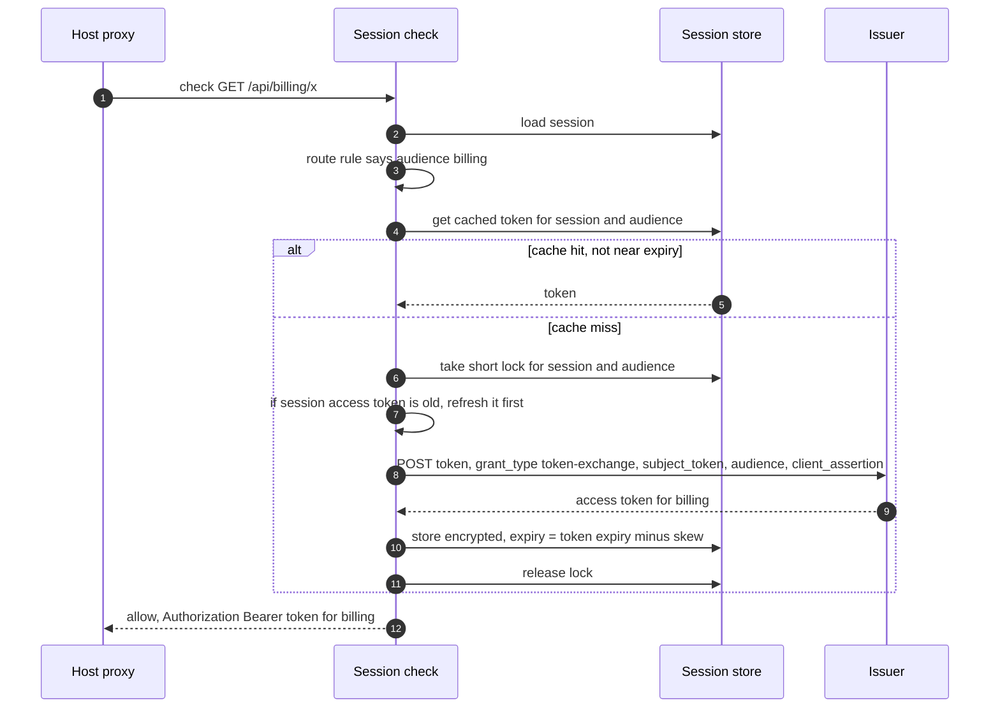
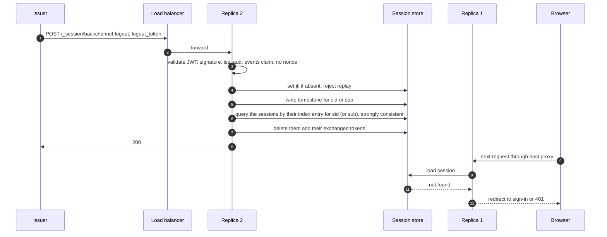

# Design of truvity/session

Status: design. No production code yet: `spike/` holds throwaway prototype code from the first spike ([findings](archive/spike-2026-11-18.md)). The state of each part is in section 16.

The decisions are in [docs/decisions](decisions/README.md), one record for each subject. This document puts them together and shows how the parts work. Where it states a rule, the record has the reasons and the roads not taken.

## 1. Purpose

`session` is a relying-party component. After an issuer has signed a person in, `session` keeps the website's browser session on the server ([0001](decisions/0001-purpose-scope-and-name.md)).

- The browser holds one opaque cookie. Tokens never reach the browser.
- The proxy in front of the site asks `session` before each request: may this pass, and with which headers?
- The issuer is sluis. Keycloak is used to build and test first.

What it replaces: the OIDC filter of Envoy Gateway, which keeps tokens in browser cookies.

What it does not replace: any part of the sluis issuer core. `session` is a client of the issuer, not a second issuer.

## 2. Goals and non-goals

| Goals | Non-goals |
| --- | --- |
| Server-side browser session for a website | Being an identity provider |
| One check core for every proxy | Authenticating API callers without a browser (the per-API door of sluis) |
| Per-API tokens, never one token valid everywhere | A policy language of its own. Cedar decides who may reach a route ([0007](decisions/0007-policy.md)); what a person may do inside an API is that API's decision |
| Works behind Envoy Gateway, nginx and AWS API Gateway | Reading request bodies |
| Small, auditable, written in Go, built on atoom | Managing issuer clients or Keycloak realms |
| Security-audit events for sign-ins, logouts and denials | Usage or billing records, ever ([0008](decisions/0008-audit.md)) |

## 3. Overview

```text
 browser  ->  host proxy  ->  site
                 |
                 +--  "may this pass?"  -->  session check  -->  session store
                                                  |
                                                  +--  sign-in, token exchange, logout  -->  issuer
```

One check core does the work. Adapters only translate between a proxy's protocol and the core.

| Piece | Job |
| --- | --- |
| Check core | Reads the cookie, loads the session, decides allow, redirect or 401, builds the headers. It is a block ([0009](decisions/0009-session-core-block.md)) |
| Adapters | Envoy external authorisation (HTTP and gRPC), nginx `auth_request`, AWS API Gateway Lambda authorizer |
| Sign-in handler | Login, callback, logout, back-channel logout, whoami, jwks |
| Exchange client | Gets and caches a token for each API audience (RFC 8693) |
| atoom ports and blocks | `store`, `key`, `source`, `transport`, and the `seal` block, called through ConnectRPC clients with the drivers in-process (section 9). Cedar is a library |
| In-path mode | The same service as a reverse proxy, for sites where one more hop is fine |

Libraries: `coreos/go-oidc`, `golang.org/x/oauth2`, `go-jose`, `cedar-go`. We write the glue, not the cryptography.

## 4. Deployment: external authorisation

The host proxy asks `session` before each request. `session` is not in the data path ([0002](decisions/0002-own-go-service-and-external-authorisation.md)).



Rules of this mode:

- The proxy sends only headers. The check never sees the body.
- The proxy strips `Authorization`, `Cookie` and identity headers that came from the browser. The allow answer sets the real ones. The example configs ship this.
- The sign-in paths (`/_session/*`) are routed to the service without a check, because they run before a session exists.
- The check fails closed. If the store is down, the answer is 503, never allow. The check bounds every store call with its own timeout (1.5 s in the first spike), and the proxy's timeout for the check is longer, so the check's 503 is the one the client sees. On nginx the example turns the check's markers, and a check that cannot be reached, into the same 503 ([0018](decisions/0018-nginx-adapter.md)).
- The check must see the same normalised path the proxy routes on. Each host example ships the settings for it.

Hosts:

| Host | How it asks | Notes |
| --- | --- | --- |
| Envoy Gateway | `SecurityPolicy` with external authorisation. gRPC mode is preferred, HTTP mode is documented | Header removal (`headers_to_remove` in gRPC, `x-envoy-auth-headers-to-remove` in HTTP), `allowed_headers` with `x-requested-with`, path normalisation, per-route disable ([0015](decisions/0015-envoy-http-mode-csrf-header-and-step-2-choices.md)) |
| nginx | `auth_request` with `auth_request_set` | Self-hosted installs. Every refusal is a 401 with markers that the example turns into the check's own answer; `$uri$is_args$args` set in the protected location; raw paths that differ from `$uri` refused; one `Set-Cookie`; 503 on failure ([0018](decisions/0018-nginx-adapter.md)) |
| AWS API Gateway | Lambda authorizer, for both the REST API and the HTTP API (payload 2.0). The docs default to the HTTP API | Cannot redirect, cannot set or remove headers, cannot send `Set-Cookie`. The authorizer cache is set to 0. Stripping is the integration's parameter mapping. The HTTP API cannot map `Authorization`, so the per-API token uses `X-Session-Token` |

The rules for each host, and the reasons, are in [0011](decisions/0011-host-adapter-rules.md), with [0015](decisions/0015-envoy-http-mode-csrf-header-and-step-2-choices.md) for Envoy and [0018](decisions/0018-nginx-adapter.md) for nginx. Every Lambda function runs behind the Web Adapter ([0012](decisions/0012-lambda.md)), except the authorizer, which is a native Go handler in the same binary ([0014](decisions/0014-authorizer-native-go-handler.md)).

The in-path mode is a plain reverse proxy that runs the same check, then forwards the request. It costs a hop, so it is for sites where that is fine.

## 5. Behaviour contract

These are the rules every host gets. They do not depend on the proxy ([0004](decisions/0004-browser-session-contract.md)).

| Id | Rule |
| --- | --- |
| S1 | Cookie `__Host-<site>`: opaque id, `Secure`, `HttpOnly`, `SameSite=Lax`, `Path=/`, no `Domain` |
| S2 | Sessions live on the server, sealed, in an atoom store driver. Each site has an idle and a maximum lifetime |
| S3 | Sign-in uses authorisation code with PKCE, always. PAR and `private_key_jwt` are used |
| S4 | Page without session: redirect to sign-in. API call: JSON 401. The API Gateway authorizer cannot redirect, so it returns the error `Unauthorized` (401, never a deny policy) and the browser helper starts sign-in. nginx makes the redirect and the 401 from the markers of the check's 401, with the check's own body |
| S5 | State-changing requests need CSRF protection: the header `X-Requested-With: XMLHttpRequest` plus `Origin` and `Sec-Fetch-Site` checks. Headers only ([0015](decisions/0015-envoy-http-mode-csrf-header-and-step-2-choices.md)) |
| S6 | Logout is a POST with CSRF, then the issuer's end-session. Back-channel logout deletes the session on all replicas |
| S8 | The browser's `Authorization`, cookies and identity headers are stripped. In external authorisation the host strips and the allow answer sets them (section 4) |

There is no S7. The ids are the ones the conformance suite cites.

### 5.1 Session record

| Field | Content |
| --- | --- |
| id | 256 random bits, only in the cookie. The store key is a keyed hash of it, so a store leak gives no usable cookie |
| subject, issuer, `sid` | From the ID token. The issuer is the session's own: on a site of several issuers, everything after the sign-in goes to it ([0034](decisions/0034-several-issuers-per-site.md)). Index entries for back-channel logout hold the session keys under `sid` and subject (section 8) |
| tokens | The sign-in access token and refresh token |
| exchanged tokens | Not in the record: one item for each audience under the session's store key, see section 7 |
| created, last seen, expires | Idle and maximum lifetime. `created` is in milliseconds, for the logout comparison (section 8) |
| claims | The person's claims cached at sign-in, which the policy decision reads (section 9) |

The record is sealed by atoom's `seal` block and bound to its address (session id and purpose) as authenticated data. A record copied under another id does not open. The data keys are per purpose and installation and are wrapped by the key port, so they can be rotated.

A new id is issued at sign-in, so a session id set before sign-in is never reused (no fixation).

Idle time is refreshed at most once a minute, to keep writes down. The default lifetimes are 30 minutes idle and 8 hours maximum. Each site sets its own.

### 5.2 Paths

`session` owns one prefix on every site, `/_session/` by default.

| Path | Method | Purpose |
| --- | --- | --- |
| `/_session/login` | GET | Start sign-in. `return_to` must be a relative path of the same site. `issuer=<id>` names the issuer; a site of several issuers without it (and without a remembered choice) sends the browser to `/_session/signin` ([0034](decisions/0034-several-issuers-per-site.md)) |
| `/_session/signin` | GET | The sign-in page of a site of several issuers: one link for each, "Sign in with \<label\>", no script. `issuer=<id>` skips it. A site of one issuer has no page: it goes to the login at once |
| `/_session/callback` | GET | Receive the code from the issuer |
| `/_session/logout` | POST | End the session. Needs CSRF headers. Answers `200 {"logout_url"}` to a request that accepts JSON, else `303` to the issuer's end-session ([0015](decisions/0015-envoy-http-mode-csrf-header-and-step-2-choices.md)) |
| `/_session/backchannel-logout` | POST | Called by the issuer |
| `/_session/whoami` | GET | JSON: subject, name, groups, session expiry |
| `/_session/jwks` | GET | Public keys of the service, for apps that verify the signed identity header |

### 5.3 Unauthenticated requests

A route says what to do without a session: `redirect` or `401`. The default is `redirect` for a top-level navigation (`GET`, `Sec-Fetch-Mode: navigate`, `Accept` includes `text/html`) and `401` for everything else. The 401 body is JSON with `error: login_required` and a `login_url`.

## 6. Sign-in



Notes:

- The sign-in transaction is short-lived (a few minutes) and used once.
- A short-lived binding cookie ties the transaction to the browser that started it.
- The callback checks the `iss` parameter (RFC 9207) against the issuer the sign-in was started at.
- A site may have several issuers ([0034](decisions/0034-several-issuers-per-site.md)). The person picks one on `/_session/signin` (or the browser comes with `?issuer=<id>`, or the site remembers the choice in a cookie when `signin.remember_choice` is set); the transaction records the issuer, and PAR, the code's redemption and the ID token's checks are that issuer's, with the site's client there. A callback whose `iss` names another issuer is refused: the mix-up defence. Where an issuer sends no `iss`, the state binds the response to the issuer chosen.
- `return_to` is stored in the transaction, never taken from the callback URL.
- PAR keeps the request parameters off the browser's URL bar. `private_key_jwt` means the service holds no shared secret.

## 7. Per-API tokens (RFC 8693)

A route can name an API audience. The check exchanges the session's token for a token that is valid only for that API, and puts it in the allow answer.



Rules:

- The request is the one the sluis v2 exchange serves: the session's access token as `subject_token` of type `access_token`, `requested_token_type` `access_token`, the route's `audience`, and the client's `private_key_jwt` assertion. No `scope` and no `resource`, which sluis refuses.
- The cache key is session id, audience and scope (empty in this version). A cached token is an item under the session's store key, sealed, and ends with the token minus a skew of 30 seconds.
- A lock (single flight) stops many parallel requests from exchanging at once: an item under the session's key, put only when absent, which ends on its own after the exchange timeout (2 seconds). The others wait for the holder's token.
- Cache entries are deleted with the session, at logout and at back-channel logout: the items under the session's key, found by prefix.
- If the exchange is refused (an OAuth error answer), the answer is 403 for that route: JSON to a request that is not a navigation, the site's error page (`error_page` in the site file, or a built-in page) to a navigation. The session stays. An issuer that does not answer is a 503.
- The access token of the sign-in is refreshed under the same lock when it ends within the skew. If the issuer refuses the refresh with `invalid_grant`, or there is no refresh token, the session ends; an outage is a 503 and the session stays.
- A route may ask for a signed identity header instead, with user and groups, for apps that cannot handle tokens: `X-Session-Identity`, a JWS of `typ` `session-identity+jwt` with `iss` the site's origin, `aud` the route's audience (or the origin), `sub`, `name`, `email` and `groups`. The service signs it through the key port with a key of its own (the purpose `identity-header`) and publishes the public keys at `/_session/jwks`. It lives a minute, and a replica reuses a header for half of that.
- Forwarding the session token itself is not offered, because one token would be valid on every API.
- The audience of a route of mode `exchange` is one the site's issuer allows ([0026](decisions/0026-exchange-targets-what-the-issuer-allows.md)). With sluis v2 as the issuer, that is a resource client only (an AWS role, Kubernetes, a database, SSH, a vendor minter, KV), never a product API: sluis's exchange issues tokens for resource clients only, and a product API takes the group identity provider's tokens. A product API behind session gets the person through the identity header, or through an exchange at an issuer that allows it, such as Keycloak. session does not refuse such an audience at start, because the site file does not say which kind of client it is; sluis refuses the exchange, and the route answers 403.
- On the API Gateway HTTP API the token travels in `X-Session-Token`, because `Authorization` is reserved there.
- On a site of several issuers the exchange and the refresh go to the session's own issuer, with the site's client and an assertion for that issuer ([0034](decisions/0034-several-issuers-per-site.md)). A route whose audience only one issuer allows answers a session of another issuer with that issuer's refusal, a 403, and the session stays; a site that wants a clean denial instead writes a policy on `principal.issuer` for the route, which runs before the exchange. The route table names no issuer.

The records are [0005](decisions/0005-tokens-per-api-and-issuers.md), for the choices of the build [0016](decisions/0016-exchange-client-and-identity-header.md), for what each issuer allows as an audience [0026](decisions/0026-exchange-targets-what-the-issuer-allows.md), and for a site of several issuers [0034](decisions/0034-several-issuers-per-site.md).

## 8. Logout

The person's own logout is simple: a POST with CSRF headers deletes the session, revokes its refresh token at the issuer when the issuer has a revocation endpoint (best effort, a failure counted), clears session's two cookies and sends the browser to the issuer's end-session, also when there was no live session (with `id_token_hint` only when there was): as JSON `{"logout_url"}` for the browser helper's `fetch`, as a `303` otherwise ([0015](decisions/0015-envoy-http-mode-csrf-header-and-step-2-choices.md), [0031](decisions/0031-logout-across-hosts.md)). What each host does at a logout is in 0031. On a site of several issuers the end-session and the revocation are the session's own issuer's; without a live session it is the remembered choice's issuer, or, when the site remembers none, the browser goes back to the site ([0034](decisions/0034-several-issuers-per-site.md)).

Logout started at the issuer arrives by back-channel logout. The issuer posts to any replica. All replicas share the store, so deleting there is enough.



Design consequences ([0010](decisions/0010-logout-pointer-items.md), [0031](decisions/0031-logout-across-hosts.md)):

- Replicas keep no session state. The next check on any replica sees the deletion at once. For this reason the first version has no local session cache.
- There is no secondary index. Each session item carries two index entries of atoom's store, `sid` and `sub`, keyed hashes of the issuer and the value, written in the session's own put; every put of the session resends them, the idle refresh included. The logout finds the sessions with a linearizable `Query` by entry, so it cannot miss a session committed before it (to confirm on the real DynamoDB service).
- One race is left: a logout that arrives before the sign-in has finished. The callback closes it with one tombstone read at session creation, never on each check. If a tombstone newer than the start of the sign-in exists, the callback ends the session it just made.
- Tombstones are written by every back-channel logout, by `sid`, or by subject when the token has no `sid`. They live as long as the maximum session lifetime.
- The `jti` of a logout token is stored until the token expires, so a replay is refused.
- On a site of several issuers there is still one back-channel path. A token is verified by the issuer its `iss` names, among the site's only, and its `sid` or subject ends only that issuer's sessions: the index entries, tombstones and `jti` are keyed by issuer ([0034](decisions/0034-several-issuers-per-site.md)).

## 9. Built on atoom: ports, blocks, policy, audit

`session` is built on [atoom](https://github.com/truvity/atoom) and has no port interfaces of its own ([0006](decisions/0006-built-on-atoom.md)). The check core is a block, built inside this repository ([0009](decisions/0009-session-core-block.md)).

| Need | From atoom | First implementation |
| --- | --- | --- |
| Sessions and their index entries, tombstones, locks, the token cache | `store` port | `store/dynamodb`. Any driver that passes the store kit: PostgreSQL and Valkey when atoom builds them |
| The keys: signing, wrapping the data keys | `key` port, with `key/route` in front of the drivers | `key/awskms`, `key/software` (a key file) |
| Sealing of records, keyed hashes of store keys, signatures by purpose | `seal` block (`blocks/seal`) | Over the key port's keys and session's own store |
| The client assertion, the identity header, the JWKS | `token` block (`blocks/token`) | Over the seal block |
| Site file and policy bundle | `source` port | `source/file` in Go over `--config-dir`, or `source/appconfig` in Go over `--source-appconfig APP/ENV/PROFILE`, exactly one ([0032](decisions/0032-atoom-0.8.0-transports-and-the-appconfig-source.md)) |
| Who may reach a route | `cedar-go` in-process, through atoom's loader `policy`, with its signed bundle, loading rules and decision test set | The signed policy bundle |
| Security-audit events | The emitter of `truvity/audit` (`github.com/truvity/audit/emitter`) over atoom's `transport` port | To the audit writer, through exactly one of: the emit socket of a transport driver (`transport-spool`, `--audit-socket`); atoom's Go `transport/nats` in the process (`--audit-nats` with its stream, subject and credentials); atoom's Go `transport/sqs` in the process, on a FIFO queue (`--audit-sqs`, the switch of a Lambda function); or a driver of JSON lines on stdout for local development (`--audit-stdout`) ([0024](decisions/0024-audit-transport-is-an-explicit-switch.md), [0032](decisions/0032-atoom-0.8.0-transports-and-the-appconfig-source.md)) |

Every port, and the `seal` and `token` blocks, is called through its generated ConnectRPC client, with the driver mounted on an in-memory transport. atoom is pinned at 0.8.0, one version for every atoom module; its token block's rotation ring is not used yet ([0032](decisions/0032-atoom-0.8.0-transports-and-the-appconfig-source.md)). Cedar is the one exception: a library by design ([0007](decisions/0007-policy.md)). The deadline and the correlation id travel with every call.

### Session store

Sessions can live in any atoom store driver that passes the kit. A driver declares its durability, strict or lossy, and `session` accepts either, because a lost session only means a new sign-in.

| Need | How |
| --- | --- |
| Expiry | A TTL attribute, plus an explicit expiry check on read, because TTL deletion is lazy |
| Idle refresh | A conditional update, at most once a minute for each session |
| Exchange lock | A conditional write with a short expiry, one item for each session and audience, under the session's key |
| Back-channel logout | Index entries per `sid` and per subject on the session item, resent by every put of it, found with a linearizable `Query` by entry ([0031](decisions/0031-logout-across-hosts.md)). A tombstone read once at creation. No secondary index |
| Token cache | Items under the session's key (`<session key>/e/<hash>`), sealed, deleted with it: one `Query` by prefix at a logout, on sites with exchange routes |
| Timeouts | Every store call has a timeout shorter than the proxy's timeout for the check, so a slow store is a down store and the check answers 503 |

Rules:

- The check reads the session item for each request, and nothing else: one strongly consistent read, which is 1 read unit on DynamoDB for an item under 4 KB. Reading tombstones on each request was tested and rejected: it costs 3 read units instead of 1. A route of mode `exchange` reads the cached token as well.
- A memory store exists for tests only and refuses to start in production mode.
- The Helm chart takes the store and key driver settings and a cloud identity. It does not run a store.

### Keys and sealing

The key port holds the keys of the `private_key_jwt` assertions, of the signed identity header and the wrapping key of the `seal` block. The key file is the simple start and works with Keycloak. AWS KMS keeps the key from ever leaving it. The JWKS of the service is published at `/_session/jwks`.

atoom's `token` block makes both JWS ([0022](decisions/0022-atoom-token-block.md)). It runs in session's process over the seal block session already runs, and the seal block signs through the key port: one key client, `key/route`, sends each purpose's calls to the driver that holds it. session gives the block its claims as JSON and keeps its rules: the claims, the lifetimes, the identity header's 30-second reuse. The header is `{"alg":"ES256","kid":"<key_id>","typ":"<type>"}`, of the type `JWT` for the client assertion and `session-identity+jwt` for the identity header. `/_session/jwks` is the block's key set of the two purposes, served with `Cache-Control: max-age=300`. The block reads each public key at its start and for each key set, and checks each signature under it before it answers.

Which driver holds each signing purpose is a start-up setting ([0019](decisions/0019-signing-keys-on-aws-kms.md)): `--key client-assertion=awskms`, `--key identity-header=awskms:<key ID, ARN or alias>` or `--key wrapping=awskms`, repeatable, and a purpose not named stays on the key file. On KMS, a purpose's key is found by the alias `alias/<prefix>/<purpose>` (the prefix `session/<site>` by default) or by the key the deployment names. The deployment makes the keys (`ECC_NIST_P256`, `SIGN_VERIFY`) and their key policy; session never makes one, and its role needs `kms:DescribeKey`, `kms:GetPublicKey` and `kms:Sign`. A missing, disabled or wrong key fails the start. The kid stays the key port's `key_id` (on KMS the key ARN and the fingerprint), and the identity header's reuse keeps KMS to about two signatures a minute for each session and audience. Rotation on KMS is a new key and a restart; before the first site that rotates, the JWKS will also keep the previous key for a while (0019).

atoom's `seal` block holds the data keys, one for each purpose of the installation `session/<site>`, never for each person ([0021](decisions/0021-atoom-policy-loader-and-seal-block.md)). It seals the session record, the sign-in record and the cached tokens (AES-256-GCM, bound to the store key as the address) and makes the keyed hashes of the store keys (HMAC-SHA384). Each data key is wrapped for the key purpose `wrapping` (ECDH-P384, on the key file or on KMS as an `ECC_NIST_P384` `KEY_AGREEMENT` key, with `kms:DeriveSharedSecret`), and the wraps live in session's store under `seal/`. An instance opens a data key once and keeps it 15 minutes, so the key port, and KMS, is asked once a key, not for each request. Every replica of an installation uses the same wrapping key. `session` decides which fields it seals. Fields that index entries or conditions use stay readable. `session` declares its purposes to the block and hands it its rules: the core may seal, open and hash under them, the token block may sign and read the public key under the two signing purposes, and nothing else.

### Policy

For a request on a route, the check decides: is a session needed, which API audience's token does the route need, and may this person reach it. The route table of the site file holds the structure (session needed, audience). Cedar decides who may reach a route. The decision runs in-process on every request. Its entities come from the session item the check already read and from the route. There is no extra read and no call to sluis. Without a bundle in the site file, the answer comes from the route table alone.

The signed policy bundle (a JWS of the kind `PolicyBundle`, ES384) is read through the `source` port by atoom's loader `policy` and verified under the one key the site file pins ([0021](decisions/0021-atoom-policy-loader-and-seal-block.md)). The loading rules (signature first, strict schema validation, atomic swap, last good set kept, cold start refused without a valid set, refresh on the file driver's watch, no I/O in a decision) and the decision test set are atoom's. Each decision carries the digest of its set, the SHA-384 of the payload in hex. A request that does not fit the bundle's schema is a denial, audited as a misfit. The entities and their schema are in [policy.md](policy.md).

### Audit

`session` emits security-audit events for sign-ins, logouts, refresh failures, token exchanges and denials. A check never waits on them. A sign-in completes only after its event is accepted by the transport; while the transport is down, a sign-in fails closed with 503 in the first version ([0015](decisions/0015-envoy-http-mode-csrf-header-and-step-2-choices.md)). When the transport is down, checks keep being answered, and dropped events are counted and raise an alert. Allowed requests are counted as metrics. Usage and billing records are never emitted ([0008](decisions/0008-audit.md)).

The emitter of `truvity/audit` runs in session's process behind `core.Auditor` ([0023](decisions/0023-audit-emitter.md)). Each event is an OCSF 1.9.0 record of session's action table (`sign-in`, `logout`, `back-channel-logout`, `denied`, `token-exchange`, `refresh`; a failure is the action's outcome), checked against the schema of its action before it leaves. The person is a pseudonym, `p1.<YYYYMM>.<value>`, a keyed hash that the seal block makes under the key of the month (the purpose `pseudonym`, label `session-pseudonym-v1`); the site, the issuer, the route and the audience are in the product object `unmapped.session`, and a policy denial carries the bundle's name and digest. A sign-in waits until the transport says its record is durable; every other event is best effort, bounded by a second, and a lost one is counted and reported by the next record. `--audit-socket` names the emit socket of a transport driver (atoom's `transport-spool`, whose consumer is the writer); `--audit-nats URL` mounts atoom's Go `transport/nats` in the process, publishing to the stream and subject the deployment made (`--audit-nats-stream`, `--audit-nats-subject`) over a connection whose credentials the host gives (`--audit-nats-creds` or `--audit-nats-token-file`, and `--audit-nats-tls-ca`); `--audit-sqs QUEUE_URL` mounts atoom's Go `transport/sqs` in the process on a FIFO queue, the switch of a Lambda function; `--audit-stdout`, for local development, mounts a driver in the process that writes each record as one JSON line to stdout. session refuses to start with none of them and with more than one, whatever `--audit-scope` says ([0024](decisions/0024-audit-transport-is-an-explicit-switch.md), [0032](decisions/0032-atoom-0.8.0-transports-and-the-appconfig-source.md)). atoom knows no deployment: the connection, the stream and the queue are the host's. `--audit-scope` is a label, the scope of the log (`local` when unset); nothing in session decides by its value, and no key driver is told it ([0027](decisions/0027-atoom-0.7.0-and-the-audit-scope-flag.md)).

## 10. Site configuration

One file per site. The schema is part of the repository, and `session check` validates it (the generator turns it into proxy config). The example shows the shape `internal/site` reads; [examples/site.yaml](../examples/site.yaml) is the full example.

```yaml
site: tools
host: tools.example.com
issuers:
  - id: corp
    label: Example Corp
    issuer: https://issuer.example.com/realms/corp-staff
    client:
      id: session-tools
      auth: private_key_jwt
    scopes: [openid, profile, email]
  - id: partner
    label: Example Partner
    issuer: https://issuer.example.com/realms/partner-staff
    client: { id: session-tools, auth: private_key_jwt }
    scopes: [openid, profile, email]
signin:
  remember_choice: 720h
session:
  idle: 30m
  max: 8h
policy:
  bundle: policy-bundle
  verify_key:
    kid: publisher-1
    public_key: |
      -----BEGIN PUBLIC KEY-----
      MHYwEAYHKoZIzj0CAQYFK4EEACIDYgAEKwsvu/lKOYwP0gNG9wTasVXZHfp1bEWk
      oSq/SzJQbWqYGN9urpU1EFl6ypRKdcc8olyuacxsRDML4ZGtDcLA2gcsTUXZGfvL
      hkPfEOilNuWdXkXOQrrZsO/Retc6BTZk
      -----END PUBLIC KEY-----
routes:
  - match: { prefix: /assets/ }
    mode: public
  - match: { prefix: /api/billing/ }
    mode: exchange
    audience: https://billing.example.com
  - match: { prefix: /api/ }
    mode: identity-header
  - match: { prefix: / }
    mode: session
```

| Section | Content |
| --- | --- |
| `issuers` | One issuer or more ([0034](decisions/0034-several-issuers-per-site.md)). Each has an `id` (1 to 32 lower-case letters, digits and `-`, unique: `?issuer=<id>`), a `label` (the sign-in page's "Sign in with \<label\>"), the issuer identifier `issuer` (an `https` URL, unique; its discovery is read at start and must offer PAR), its `client` (`id`, and `auth: private_key_jwt`; the key is the key port's purpose `client-assertion`, one key for every issuer, held by a start-up key driver) and its `scopes` (with `openid`). With one issuer there is no sign-in page. The top-level `issuer`, `client` and `scopes` of before are refused |
| `signin` | `remember_choice`: a duration, off when unset. When set on a site of several issuers, the issuer a person signed in with is kept in the cookie `__Host-<site>-issuer` for that long, and a login that names no issuer goes to it without the page |
| `session` | The idle and the maximum lifetime |
| `policy` | The name of the signed bundle (a document of the source port) and the one key that verifies it: its `kid` and its P-384 public key as PEM. Without a bundle, the route table decides alone |
| `routes` | The route table |

| Route mode | Allow answer carries |
| --- | --- |
| `public` | Nothing. No session needed |
| `session` | Only that the session is valid, plus the cookie-stripped `Cookie` header |
| `exchange` | `Authorization: Bearer` with the token for the audience (`X-Session-Token` on the API Gateway HTTP API) |
| `identity-header` | A signed identity header, `X-Session-Identity`. The route's optional `audience` is its `aud` |

Routes are matched in order. The first match wins; a path that matches no route is a 404 `no_route`. A route of mode `exchange` must name its `audience`; the modes `public` and `session` take none. `error_page` names a document of the source port: the HTML page a navigation gets when an exchange is refused ([0016](decisions/0016-exchange-client-and-identity-header.md)). The site file is read through the `source` port as the document `site` (the file `site.jws`), the policy bundle as `policy-bundle` (`policy-bundle.jws`). The check matches on the normalised path, and the host proxy must route on the same normalised path (see the threat model). On Lambda the site file and the policy bundle are the configuration layer ([0012](decisions/0012-lambda.md)). Which store and key drivers run, and where the security-audit records go (`--audit-socket` or `--audit-stdout`, [0024](decisions/0024-audit-transport-is-an-explicit-switch.md)), is a start-up setting, not part of the site file.

## 11. Repository contents

Paths are planned ([0003](decisions/0003-repository-contents.md)).

| In the repository | Path |
| --- | --- |
| The check service, image and Helm chart: 2 replicas, Service, NetworkPolicy, store and key driver settings, cloud identity | `cmd/session`, `charts/session` |
| The session core, the block | `core/` |
| Lambda packaging: the Web Adapter layer pin, the configuration layer, the function definitions | `lambda/` |
| Example host configs: Envoy `SecurityPolicy`, nginx, API Gateway | `examples/` |
| The site file schema, the `session check` validator and generator | `schema/`, `cmd/session` |
| Browser helper in TypeScript: `apiFetch` (401 gives a re-login hint), `whoami`, `signOut` as POST with CSRF | `web/` |
| Conformance suite: headless browser, run in CI through every host against a test Keycloak (a test sluis at step 6) | `conformance/` |
| The route policy cases and the policy bundle of the examples | `policy/` |
| Docs: site file reference, "put a site behind it" guide, threat model | `docs/` |

The atoom pin is the release in `go.mod`: 0.8.0, one version for every atoom module. An upgrade is a deliberate bump. While atoom's contracts are `v1alpha1`, a breaking change raises atoom's minor version, and `session` follows it on purpose.

Not in the repository:

- the per-API door for API callers (the sluis resource-proxy sidecar);
- Keycloak realm configuration;
- Envoy routing and cluster configuration, which belong to the repositories of whoever deploys a site.

## 12. Issuers and the sluis v1 check

| Issuer | Role |
| --- | --- |
| sluis v2 | The target, once its FAPI work lands (PAR, `private_key_jwt`). Its exchange serves resource-client audiences only ([0026](decisions/0026-exchange-targets-what-the-issuer-allows.md)) |
| Keycloak | Has PAR and `private_key_jwt` now. Used to build and test first |

Does the token exchange of sluis v1 accept the proxy's sign-in token? No. v1 accepts a sign-in access token only from a `public` client that declares `sign_in_exchange`, and `session` is a confidential `private_key_jwt` client. v1 also has no PAR and no `private_key_jwt`. Sites on v1 wait for v2, and a public-client workaround is rejected ([0005](decisions/0005-tokens-per-api-and-issuers.md)). What `session` needs from v2: its token exchange accepts the access token of a confidential `private_key_jwt` client's live sign-in as subject token, presented by the same client, for a resource client's audience, and refuses an ID token and a token the exchange itself issued. sluis plans it as its requirement REQ-EXCH-032; with v2, a route of mode `exchange` names a resource client only ([0026](decisions/0026-exchange-targets-what-the-issuer-allows.md)).

## 13. Threat model (summary)

The full model goes into `docs/threat-model.md` with the first code.

| Threat | Answer |
| --- | --- |
| Token theft from the browser | Tokens never leave the server. The cookie is `HttpOnly` and `__Host-` |
| Stolen store contents | Session records are sealed and bound to their address. The store key is a keyed hash of the id |
| Copying a sealed record to another session | The address is authenticated data, so it does not open |
| Compromise of a data key or the key that wraps it | Keys are per purpose and installation, wrapped by the key port (AWS KMS where the key must not leave), and rotated. A session is short-lived by its maximum lifetime |
| CSRF | `SameSite=Lax`, a custom header, `Origin` and `Sec-Fetch-Site` checks (S5) |
| Session fixation | New id at sign-in |
| Open redirect | `return_to` must be a relative path, kept server-side |
| Login CSRF and code injection | State plus binding cookie, PKCE, `iss` check |
| Mix-up between the issuers of one site | The transaction records the issuer chosen; the callback refuses an `iss` of another issuer, redeems the code at the chosen issuer only, with an assertion for it, and takes only its ID token. A back-channel logout token ends only its own issuer's sessions ([0034](decisions/0034-several-issuers-per-site.md)) |
| Header spoofing | The host strips browser headers, the allow answer sets them (S8). The examples ship this |
| Path confusion between proxy and check | Both use the normalised path. Reproduced in the first spike on nginx with `$request_uri`. The conformance suite sends dot-segment, encoded-dot and merged-slash paths to every host, and the examples ship Envoy `normalize_path`, `merge_slashes` and `path_with_escaped_slashes_action`, and nginx `$uri$is_args$args` (read in the protected location, not the subrequest's) with dot segments and encoded dots, slashes and backslashes refused, because nginx passes the site the raw URI ([0018](decisions/0018-nginx-adapter.md)) |
| Replay of logout tokens | `jti` stored until the token expires |
| Store outage | Fail closed, with a timeout on every call |
| Lossy store loses sessions | Accepted: the person signs in again |
| A tampered or stale policy bundle | The signature is verified before parsing. A failed reload keeps the last good set, and a cold start without a valid set refuses to run. Each decision is audited with the digest of its set |
| Audit loss | Security-audit events may be dropped when the transport is down. Drops are counted and raise an alert. A check is never blocked by audit |
| Token blast radius | One token per API audience. No token valid everywhere |
| A forged or replayed identity header | The host strips the browser's (S8). The header is signed by a key of its own, has its own `typ`, and lives a minute; an app checks `typ`, `iss`, `aud` and `exp` against `/_session/jwks` |
| A cached token outliving a logout | Cached tokens live under the session's key and are deleted with it; a check reads the session before the cache |
| Cross-site embedding | `SameSite=Lax` and no `Domain`. Sites are separate hosts |

## 14. Testing

The conformance suite (`conformance/`, `just test-conformance`, [0020](decisions/0020-conformance-suite.md)) drives a real headless browser (Chromium's headless shell, through chromedp) through the real flows, with each host in turn: Envoy over gRPC, Envoy over HTTP and nginx, each running its example configuration as it is, against a test Keycloak. The steps are the same on every host: a public route and the JSON 401 without a session; the sign-in redirect, Keycloak's form and the callback, with the S1 cookie read from the browser; a protected route with header stripping (S8); the sign-in prefix without a check; CSRF with and without the header (S5); the exchange and identity-header routes, verified against the realm and `/_session/jwks`; a refused exchange; a store outage (503); the dot-segment, encoded-dot, encoded-slash and merged-slash paths; the logout and Keycloak's end-session (S6); back-channel logout; and a refresh refused after a logout the issuer did not send. A second stand has two issuers, two realms of the test Keycloak, and runs through Envoy over gRPC: the sign-in page, `?issuer=`, a sign-in through each, a mix-up refused, a policy by issuer, the exchange at the session's issuer, and logout and back-channel logout through the right issuer ([0034](decisions/0034-several-issuers-per-site.md)). Where the hosts differ by design (a 503 without its body in Envoy's HTTP mode, nginx's 400 on a bad path and its single `Set-Cookie`), the suite asserts each host's answer. The browser is on TLS, because the cookie is `Secure` and the CSRF rule wants an `https` origin; the bad paths are sent outside the browser, which would normalise them.

Not yet in the suite: the API Gateway authorizer (step 5, in a real account), a test sluis (step 6), back-channel logout across two replicas, session expiry in the browser, and policy decisions, which session's own tests check through atoom's loader (atoom's decision test set holds `cedar-go` to `cedar-policy`). The suite also carries the Keycloak findings of the group SSO reference stand ([0013](decisions/0013-reference-stand.md)) that are built: a redirect only on a navigation, and `id_token_hint` at logout.

## 15. Decisions

| Topic | Record |
| --- | --- |
| Purpose, scope, name | [0001](decisions/0001-purpose-scope-and-name.md) |
| Our own Go service, external authorisation | [0002](decisions/0002-own-go-service-and-external-authorisation.md) |
| Repository contents | [0003](decisions/0003-repository-contents.md) |
| The browser session contract, defaults, paths, lifetimes | [0004](decisions/0004-browser-session-contract.md) |
| Per-API tokens, identity header, refresh, issuers, the sluis v1 check | [0005](decisions/0005-tokens-per-api-and-issuers.md) |
| atoom ports, drivers, stores, sealing | [0006](decisions/0006-built-on-atoom.md) |
| Policy: Cedar as a library, the shared bundle | [0007](decisions/0007-policy.md) |
| Audit: security class only, never usage | [0008](decisions/0008-audit.md) |
| The session core as a block | [0009](decisions/0009-session-core-block.md) |
| Logout: the tombstones (the pointer items superseded by 0031) | [0010](decisions/0010-logout-pointer-items.md) |
| Host adapter rules, API Gateway handlers and caching | [0011](decisions/0011-host-adapter-rules.md) |
| Lambda: the Web Adapter, layers | [0012](decisions/0012-lambda.md) |
| The authorizer is a native Go handler | [0014](decisions/0014-authorizer-native-go-handler.md) |
| The group SSO reference stand | [0013](decisions/0013-reference-stand.md) |
| Envoy HTTP mode, the CSRF header, the choices of step 2 | [0015](decisions/0015-envoy-http-mode-csrf-header-and-step-2-choices.md) |
| The exchange client and the identity header, the choices of step 3.1 | [0016](decisions/0016-exchange-client-and-identity-header.md) |
| The nginx adapter, the choices of step 3.2 | [0018](decisions/0018-nginx-adapter.md) |
| Signing keys on AWS KMS, the choices of step 3.3 | [0019](decisions/0019-signing-keys-on-aws-kms.md) |
| The conformance suite, the choices of step 3.4 | [0020](decisions/0020-conformance-suite.md) |
| atoom 0.5.0: the policy loader and the seal block | [0021](decisions/0021-atoom-policy-loader-and-seal-block.md) |
| atoom 0.6.0: the token block | [0022](decisions/0022-atoom-token-block.md) |
| The emitter of truvity/audit, the choices of step 3.7 | [0023](decisions/0023-audit-emitter.md) |
| The audit transport is an explicit switch, not a value of `--environment` | [0024](decisions/0024-audit-transport-is-an-explicit-switch.md) |
| The first version for the first sites (step 4), and what step 5 waits for | [0025](decisions/0025-first-version-for-the-first-sites.md) |
| The mode `exchange` targets what the issuer allows: with sluis v2, resource clients only | [0026](decisions/0026-exchange-targets-what-the-issuer-allows.md) |
| atoom 0.7.0 and `--audit-scope`: the key drivers are told no installation | [0027](decisions/0027-atoom-0.7.0-and-the-audit-scope-flag.md) |
| The image, and what else a deployed first site needs from this repository | [0028](decisions/0028-the-image.md) |
| The remote runner: the conformance scenarios against a deployed site, and the echo test backend | [0029](decisions/0029-the-remote-runner.md) |
| The Lambda handlers, the choices of step 5 before atoom's B9 | [0030](decisions/0030-lambda-handlers-step-5-choices.md) |
| Logout across hosts: end-session, back-channel logout, the lookup, cookies and audit | [0031](decisions/0031-logout-across-hosts.md) |
| atoom 0.8.0: the audit transports NATS and SQS, and the AppConfig source | [0032](decisions/0032-atoom-0.8.0-transports-and-the-appconfig-source.md) |
| Several issuers per site: the sign-in page, a flow per issuer, the session's own issuer for everything after | [0034](decisions/0034-several-issuers-per-site.md) |

## 16. Status and next steps

Built: nothing in production, so nothing sealed under an earlier format has to be read again. The first spike ran the check core, Envoy, nginx and the Lambda handlers on sample events against Keycloak and DynamoDB Local ([findings](archive/spike-2026-11-18.md), [code](../spike/)). session runs on atoom 0.8.0: the `store`, `key` and `source` ports and their drivers, `key/route`, the `seal` and `token` blocks and the Cedar loader `policy` ([0021](decisions/0021-atoom-policy-loader-and-seal-block.md), [0022](decisions/0022-atoom-token-block.md), [0027](decisions/0027-atoom-0.7.0-and-the-audit-scope-flag.md), [0032](decisions/0032-atoom-0.8.0-transports-and-the-appconfig-source.md)), and its security-audit records go through the emitter of `truvity/audit` 0.19.0 over the `transport` port ([0023](decisions/0023-audit-emitter.md)).

The fit spike ran the check core on atoom's `store/dynamodb`, `key/software` and `source/file` in-process, and the authorizer events through the Lambda Web Adapter ([findings](spike-2026-11-22.md), [code](../spike/)). The real-AWS checks are a script for the maintainer, not yet run.

Planned, in order:

1. **Fit spike**, about a day (done, not yet in an account: [findings](spike-2026-11-22.md)): the check core on atoom 0.2.0's `store/dynamodb` and `key` drivers mounted in-process; authorizer events through the Lambda Web Adapter; the short check in a real AWS account that the first spike could not make (section 17).
2. **Check core, sign-in handler and Envoy adapters** against Keycloak, about four to five days. The broker rules and the browser library come from the group SSO reference stand where they fit.
3. **nginx adapter, AWS KMS, the exchange client and the conformance suite**, with the stand's scenarios and Keycloak findings, about three to four days. It needed from atoom the `seal` block, the Go `source/file` driver, the Cedar loader with its decision test set and the durability field, and from `truvity/audit` the emitter in Go, all now built. One pull request for each part:
   1. **The exchange client and the identity header** (built, [0016](decisions/0016-exchange-client-and-identity-header.md)): the route modes `exchange` and `identity-header`, tested against Keycloak's standard token exchange and through Envoy. Needs nothing new from atoom.
   2. **The nginx adapter** (built, [0018](decisions/0018-nginx-adapter.md)): `auth_request` with the markers of [0011](decisions/0011-host-adapter-rules.md), the example config `examples/nginx/nginx.conf`, tested through nginx 1.30 as it is.
   3. **AWS KMS** (built, [0019](decisions/0019-signing-keys-on-aws-kms.md)): the `key/awskms` driver as a start-up setting for each of the client assertion and the identity header (`--key PURPOSE=awskms[:KEY]`), tested on an in-process KMS double and against Keycloak. Needs nothing newer from atoom: `key/awskms` 0.3.0. The real-AWS check is part of step 5.
   4. **The conformance suite** (built, [0020](decisions/0020-conformance-suite.md)): `conformance/`, `just test-conformance`, in CI. Chromium's headless shell, driven by chromedp, runs the same scenarios through Envoy over gRPC, Envoy over HTTP and nginx, each with its example as it is, against Keycloak, and asserts each host's documented answer where the hosts differ. API Gateway and the Lambda authorizer cannot run without AWS: their run of the scenarios is part of the real-AWS check of step 5.
   5. **atoom 0.5.0** (built, [0021](decisions/0021-atoom-policy-loader-and-seal-block.md)): every atoom pin at 0.5.0; atoom's policy loader in place of the interim one (a signed bundle, one pinned key, strict schema validation, the SHA-384 digest); atoom's `seal` block in place of the local sealer (the wrapping key on the key port, the wraps in session's store). The sealed format changed; nothing was deployed.
   6. **atoom 0.6.0** (built, [0022](decisions/0022-atoom-token-block.md)): every atoom pin at 0.6.0; atoom's `token` block in place of session's own JWS code for the client assertion, the identity header and `/_session/jwks`, over the seal block, with `key/route` in front of the key drivers. Issuers and apps see the same headers, claims and keys.
   7. **The emitter of `truvity/audit`** (built, [0023](decisions/0023-audit-emitter.md)): `github.com/truvity/audit/emitter` 0.19.0 in place of the stand-in, with every atoom pin still at 0.6.0. session's action table and schemas in code, the pseudonyms made by the seal block under a key for each month, a blocking emit for a sign-in and best effort for the rest; `--audit-socket` to the emit socket of a transport driver, or `--audit-stdout`, a driver of JSON lines on stdout for local development; exactly one of them, whatever the scope's label says ([0024](decisions/0024-audit-transport-is-an-explicit-switch.md)).
   8. **atoom 0.7.0** (built, [0027](decisions/0027-atoom-0.7.0-and-the-audit-scope-flag.md)): every atoom pin at 0.7.0, in which the key drivers know no deployment shapes. session tells no key driver an installation, and `--environment` is renamed `--audit-scope`, the scope of the audit log only (breaking, start-up). A deployment keeps keys out of files with `--key PURPOSE=awskms`. The emitter of `truvity/audit` 0.19.0 runs unchanged on it.
4. **First version** for the first sites ([0025](decisions/0025-first-version-for-the-first-sites.md)): Keycloak as the issuer; staff-facing sites on a development environment, behind Envoy; the signing keys on AWS KMS; audit through the spool sidecar's socket on the cluster (`--audit-socket`); no key rotation at the first sites. Done when the conformance scenarios pass against the deployed site. The version is the release `v0.1.0`, tagged on the owner's approval.
   - **The image** (built, [0028](decisions/0028-the-image.md)): `ghcr.io/truvity/session`, `master-<commit>` from `master` and `X.Y.Z` from a tag.
   - **The remote runner** (built, [0029](decisions/0029-the-remote-runner.md)): `just test-remote HOST=...` runs the scenarios that need no movable clock, no store double and no admin API against the deployed site, signing in through the brokered upstream (mimic on development, by `kc_idp_hint` and `login_hint`), with the site file `conformance/remote/site.yaml` whose short lifetimes let the idle and absolute expiry run in real time. The site routes to the test backend `ghcr.io/truvity/session-echo`. Audit is checked only when a reader of the spool is given. An agent runs it from a workstation first; CI later.
   - **atoom 0.8.0** (built, [0032](decisions/0032-atoom-0.8.0-transports-and-the-appconfig-source.md)): every atoom pin at 0.8.0. The first sites keep `--audit-socket` to the spool sidecar; `--audit-nats`, atoom's Go `transport/nats` in the process with the host's connection and credentials (`--audit-nats-stream`, `--audit-nats-subject`, `--audit-nats-creds`, `--audit-nats-token-file`, `--audit-nats-tls-ca`), is a fourth audit switch for a site whose writer reads a JetStream stream (D65 A), tested against a NATS server with JetStream in CI. Still no key rotation at the first sites: the token block's rotation ring (atoom's B8b) is not adopted, and is the next step before the first site that rotates a signing key.
   - **Several issuers per site** (built, [0034](decisions/0034-several-issuers-per-site.md), D84 A): the site file's `issuers` list (breaking: the top-level `issuer`, `client` and `scopes` are gone), the sign-in page `/_session/signin` with one link for each issuer and `?issuer=<id>` to skip it, the remembered choice as `signin.remember_choice` (off by default), a PAR and PKCE flow per issuer with the callback bound to the issuer chosen (RFC 9207 `iss`, else the state), and the session's issuer for the exchange, the refresh, the end-session and back-channel logout. The first site is an internal tool that the staff of every vendor sign in to, each vendor's staff realm an issuer of its own (D83). Tested with two Keycloak realms in the conformance suite; the remote runner's `ISSUER=` names the issuer by its id.
5. **Lambda:** the sign-in handler behind the Web Adapter and the authorizer as a native Go handler ([0014](decisions/0014-authorizer-native-go-handler.md)), HTTP API first, then REST API. The real-AWS check runs the conformance scenarios through API Gateway ([0020](decisions/0020-conformance-suite.md)). It depended on atoom's B9 ([0025](decisions/0025-first-version-for-the-first-sites.md)), released in atoom 0.8.0: a Go `transport/sqs` driver mounted in the process for audit, because Lambda has no spool sidecar, and the Go `source/appconfig` driver for the site file and the policy bundle ([0030](decisions/0030-lambda-handlers-step-5-choices.md)).
   - **The handlers** (built, [0030](decisions/0030-lambda-handlers-step-5-choices.md)): `session authorizer`, the native handler of both API Gateway products in `internal/apigateway`, with the answers, the context keys and the integration's parameter mapping; the sign-in function is `session serve --check-grpc ''` behind the Web Adapter, with no code of its own. Unit-tested in the process on the fit spike's sample events, with audit through the in-process transport driver.
   - **atoom's B9** (built, [0032](decisions/0032-atoom-0.8.0-transports-and-the-appconfig-source.md)): `--audit-sqs QUEUE_URL`, atoom's Go `transport/sqs` in the process on a FIFO queue (D44 A), and `--source-appconfig APP/ENV/PROFILE`, atoom's Go `source/appconfig` in the process (D71 A), the site file the profile `PROFILE` and every other document the profile of its name. Exactly one of the four audit switches, and exactly one of `--config-dir` and `--source-appconfig`. Next: the packaging under `lambda/` and the real-AWS run.
   - **Then logout across hosts** (built, [0031](decisions/0031-logout-across-hosts.md)): the logout lookup by atoom's index entries in place of pointer items, the issuer's end-session also without a live session, the refresh token revoked at the person's logout (RFC 7009, best effort), both of session's cookies cleared.
6. **sluis v2 as an issuer** once PAR and `private_key_jwt` land there ([0026](decisions/0026-exchange-targets-what-the-issuer-allows.md)). The scope is resource-client audiences: a route of mode `exchange` on a sluis v2 site names an AWS role, Kubernetes, a database, SSH, a vendor minter or KV, and the site's product APIs use the identity header. It waits for sluis's requirement REQ-EXCH-032, the exchange of a confidential `private_key_jwt` sign-in client's live sign-in token for a resource client (question 3 below). Sites on sluis v1 wait for v2.
7. **The session core moves into atoom** when sluis's sign-in actor adopts it.

## 17. Open questions

Not decided. The first spike could not settle them without a real AWS account, or they depend on work elsewhere.

1. Items from the AWS documentation that were not run in a real account: the HTTP API status for `isAuthorized: false`, the HTTP API default cache TTL, and integration parameter mapping with `$context.authorizer.*` (including the non-reserved token header).
2. Real DynamoDB latency from the target region for the one strongly consistent read of each check, to confirm or reverse "no local cache". The first spike measured DynamoDB Local only.
3. Narrowed: sluis v2's token exchange and session's subject token ([0026](decisions/0026-exchange-targets-what-the-issuer-allows.md), from sluis's records on `main`, read 2026-11-25).
   - Decided, the targets: sluis's exchange issues tokens only for resource clients, whatever the subject token is, and a product API takes the group identity provider's tokens ([sluis 0051](https://github.com/truvity/sluis/blob/main/docs/decisions/0051-exchange-targets-resource-clients-only-and-policy-decides-who-gets-what.md), [sluis 0048](https://github.com/truvity/sluis/blob/main/docs/decisions/0048-product-apis-take-the-identity-providers-tokens.md)). With sluis v2 as the issuer, a route of mode `exchange` names a resource client only; product APIs get the identity header, or an exchange at an issuer that allows it, such as Keycloak.
   - Decided, the subject today: refused. Until `private_key_jwt` is supported, sluis's exchange accepts as subject token only a token issued to a public client of the native profile, and lifting that rule needs a marker against exchanging an exchanged token first ([sluis 0022](https://github.com/truvity/sluis/blob/main/docs/decisions/0022-workload-identity-and-host-enrolment.md), requirement REQ-EXCH-020).
   - Open, on the sluis side: the planned row REQ-EXCH-032, which lifts REQ-EXCH-020 for a confidential sign-in client that authenticates by `private_key_jwt` once `private_key_jwt` and that marker are built: the exchange accepts the access token of that client's live sign-in as subject token, presented by the same client, for a resource client's audience, and refuses an ID token and a token the exchange itself issued. When it is built is sluis's to say. Also open there: whether that client signs in by the authorization code with PAR, which sluis serves only to public clients today.
4. Decided: authorizer events do not go through the Lambda Web Adapter; the authorizer is a native Go handler ([0014](decisions/0014-authorizer-native-go-handler.md)).
5. Decided: a sign-in fails closed while the audit transport is down, in the first version ([0015](decisions/0015-envoy-http-mode-csrf-header-and-step-2-choices.md)).
6. Decided: a signing key on AWS KMS rotates by a restart for now ([0019](decisions/0019-signing-keys-on-aws-kms.md)); the previous key stays in the JWKS for a while, built before the first site that rotates. The first version has no key rotation at the first sites, and that build comes with atoom's B8b, the rotation ring of the token block ([0025](decisions/0025-first-version-for-the-first-sites.md)).
